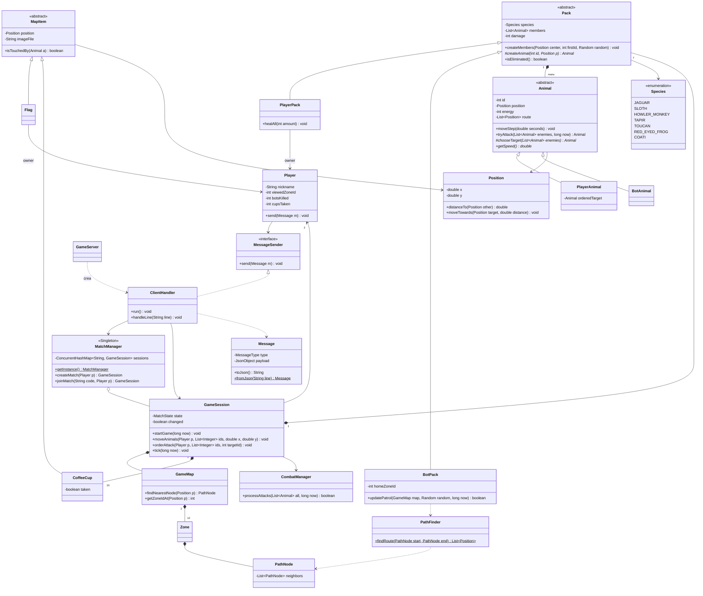

# Jungle Attack - Spec del Servidor

Este documento describe el proyecto **jungle-attack-server**: qué hace el servidor, cómo se comunica con los clientes, sus paquetes y clases, los algoritmos que usa y cómo lo vamos a probar.

El cliente tiene su propio repositorio y su propio spec (`Spec-cliente.md`).

---

## 1. Qué hace el servidor

- Es la **autoridad** del juego. Él calcula todo: movimiento, ataques, cafés, bonos y quién gana.
- Los clientes solo le dicen lo que el jugador **quiere hacer**, por ejemplo "mover estos animales aquí".
- Los dos clientes nunca hablan entre ellos. Todo pasa por el servidor, con **sockets** y mensajes **JSON** (un JSON por línea).
- Puede tener **N partidas** al mismo tiempo.
- **No manda la posición de todo cada 50 ms.** Solo avisa cuando algo cambia, y en cada aviso manda **hacia dónde va** cada animal. Así cada cliente mueve a los animales por su cuenta (ver sección 3).

---

## 2. Reglas que decidimos

Además de las reglas del enunciado, decidimos lo siguiente:

- **Mapa:** 12 zonas en una cuadrícula de 4 columnas x 3 filas. Cada zona mide lo mismo que la pantalla del cliente (800 x 600).
- **Caminos:** cada zona tiene un nodo en el centro y una "puerta" hacia cada zona vecina. El centro se une con sus puertas, y cada puerta se une con la puerta de la zona vecina. Así el mapa es un **grafo** y los animales solo caminan por esas líneas.
- **Destino:** cuando el jugador hace clic, el servidor busca el **nodo más cercano** al clic y manda a los animales hasta ahí por la ruta que encuentra **BFS**.
- **Bots:** cada pack bot **patrulla su propia zona**. Camina junto a un nodo al azar de su zona, espera unos segundos y escoge otro. Nunca sale de su zona. Si un enemigo entra en su rango, **se detiene a pelear**. Camina más lento que los animales del jugador.
- **Cafés:** los 10 cafés se ponen en puertas escogidas al azar, sin repetir.
- **Bandera:** cada jugador tiene su bandera en el centro de su zona inicial.
- **Pack sin animales:** si a un jugador se le mueren todos sus animales, pierde.
- **Desconexión:** si un jugador se desconecta antes de que entre el otro, la partida se borra. Si se desconecta después, **gana el otro jugador**.
- **Orden de ataque:** el animal del jugador solo ataca a su objetivo mientras esté dentro del rango. Si el objetivo muere o se aleja, deja de atacar.
- **Zona que se ve:** el jugador solo puede ver una zona donde tenga animales vivos. Si se queda sin animales en la zona que está viendo, el servidor lo cambia a otra zona donde sí tenga.
- **Especies:** las 7 son animales nativos de Costa Rica (ver el enum `Species`).

---

## 3. Comunicación (mensajes)

Cada mensaje es una línea JSON con `type` y `payload`:

```json
{ "type": "MOVE_ANIMALS", "payload": { "animalIds": [3, 4, 7], "targetX": 812, "targetY": 344 } }
```

### Cómo se mantienen actualizados los clientes

- El servidor actualiza el juego 20 veces por segundo, pero **no** manda un mensaje en cada actualización.
- Le manda un `ZONE_UPDATE` a un jugador **solo cuando**:
  - algo cambió: una orden de movimiento, un ataque, una muerte, un café tomado, un bot que empezó a caminar o un cambio de zona;
  - entró o salió un animal de la zona que el jugador está viendo;
  - pasó 1 segundo desde el último (es un chequeo, por si algo se desfasó).
- Cada animal del `ZONE_UPDATE` trae su posición, su velocidad y **la ruta que le falta**. El cliente lo va moviendo solo con el mismo cálculo que usa el servidor.
- El servidor solo manda lo que el jugador puede ver: **todos sus animales**, más lo que haya en **la zona que está viendo** (bots, animales rivales, cafés y bandera). Así se cumple la niebla de guerra.
- Resultado: en vez de 20 mensajes por segundo por cliente, se mandan más o menos entre 1 y 5.

### Cliente → Servidor

- `CREATE_MATCH`: `nickname`
- `JOIN_MATCH`: `nickname`, `code`
- `SELECT_ANIMAL`: `species`
- `MOVE_ANIMALS`: `animalIds`, `targetX`, `targetY`
- `ATTACK`: `animalIds`, `targetId`
- `VIEW_ZONE`: `zoneId`

### Servidor → Cliente

- `MATCH_CREATED`: `code`
- `MATCH_JOINED`: `code`, `opponent`
- `ANIMAL_SELECTION`: `available` (lista de especies), `mySpecies`, `opponentSpecies`
- `GAME_STARTED`: `columns`, `rows`, `zoneWidth`, `zoneHeight`, `paths` (lista de líneas `[x1, y1, x2, y2]` para dibujar los caminos), `myZoneId`, `mySpecies`, `opponent`
- `ZONE_UPDATE`: `viewedZoneId`, `myZones`, `animals`, `items`, `myDamage`, `myCups`, `myBotsKilled`, `seconds`, `events` (textos cortos, como "Tu pack tomó un café")
  - Cada animal: `id`, `species`, `x`, `y`, `energy`, `mine`, `bot`, `speed`, `route` (lista de puntos `[x, y]`)
  - Cada item (café o bandera): `id`, `x`, `y`, `image`
- `GAME_OVER`: `winner`, `reason`, `seconds`, `players` (por jugador: `nickname`, `species`, `botsKilled`, `cups`, `deadAnimals`), `bots` (por pack bot: `species`, `deadAnimals`)
- `ERROR`: `message` (por ejemplo "La partida ya está llena")

### Flujo de una partida

1. A manda `CREATE_MATCH` y recibe `MATCH_CREATED` con el código.
2. B manda `JOIN_MATCH`. Los dos reciben `MATCH_JOINED` y después `ANIMAL_SELECTION`.
3. Cada uno manda `SELECT_ANIMAL`, y los dos reciben `ANIMAL_SELECTION` actualizado.
4. Cuando los dos escogieron, los dos reciben `GAME_STARTED` y su primer `ZONE_UPDATE`.
5. Durante el juego, los clientes mandan `MOVE_ANIMALS`, `ATTACK` y `VIEW_ZONE`, y reciben `ZONE_UPDATE`.
6. Al final, los dos reciben `GAME_OVER`.

---

## 4. Tecnologías

- **Java 17** (la misma versión en el cliente)
- **Maven** (`mvn test`, `mvn package`)
- **Gson** para JSON
- **JUnit 5** para las pruebas
- **GitHub Actions** corre `mvn test` en cada push

---

## 5. Paquetes

```
src/main/java/com/jungleattack/server/
├── util/       GameConstants, Position
├── model/      Species, Animal, PlayerAnimal, BotAnimal, Pack, PlayerPack, BotPack,
│               Player, MapItem, Flag, CoffeeCup
├── map/        PathNode, Zone, GameMap, PathFinder
├── game/       MatchState, GameSession, CombatManager, GameException
├── lobby/      MatchManager
├── protocol/   MessageType, Message
└── network/    MessageSender, GameServer, ClientHandler
```

Son **27 clases**. Las pruebas van en `src/test/java` con los mismos paquetes.

---

## 6. Clases

Notación: `+` público, `-` privado, `#` protegido.

### 6.1 `util`

**`GameConstants`** (clase final, todo `static`, constructor privado)
Guarda todos los números del juego, para no tener números sueltos en el código.

- **Red:** `SERVER_PORT = 5000`
- **Código de partida:** `CODE_LENGTH = 4`, `CODE_CHARACTERS = "A..Z0..9"`
- **Mapa:** `ZONE_COLUMNS = 4`, `ZONE_ROWS = 3`, `ZONE_WIDTH = 800`, `ZONE_HEIGHT = 600`, `DOOR_MARGIN = 40`
- **Pack del jugador:** `PLAYER_PACK_SIZE = 10`, `PLAYER_START_ENERGY = 20`, `MAX_PLAYER_ENERGY = 20`, `PLAYER_START_DAMAGE = 2`
- **Pack bot:** `BOT_PACK_SIZE = 4`, `BOT_START_ENERGY = 10`, `BOT_DAMAGE = 1`
- **Cafés y bono:** `COFFEE_CUP_COUNT = 10`, `COFFEE_DAMAGE_BONUS = 1`, `BOTS_KILLED_FOR_BONUS = 2`, `ENERGY_BONUS = 1`
- **Movimiento:** `ANIMAL_SPEED = 80` y `BOT_SPEED = 50` (en píxeles por segundo), `SPAWN_SPREAD = 30`
- **Distancias:** `ENCOUNTER_RADIUS = 40`, `PICKUP_RADIUS = 20`, `FLAG_RADIUS = 30`
- **Tiempos:** `TICK_MS = 50`, `ATTACK_COOLDOWN_MS = 1000`, `BOT_WAIT_MS = 3000`, `SYNC_MS = 1000`
- **Mensajes de error:** `ERROR_BAD_CODE`, `ERROR_MATCH_FULL`, `ERROR_SPECIES_TAKEN`, etc.

**`Position`**
Un punto `(x, y)` del mapa. Es **mutable**: cuando un animal camina, su posición cambia.
```
- double x
- double y
+ Position(double x, double y)
+ Position(Position other)                         // crea una copia
+ getX(), getY(), setX(), setY()
+ distanceTo(Position other): double               // Pitágoras
+ moveTowards(Position target, double distance)    // avanza hacia target sin pasarse
```
Cuidado: dos objetos no deben compartir la misma `Position`. Cuando se necesite la misma posición en otro lado, se usa la copia.

### 6.2 `model`

**`Species`** (enum)
```
JAGUAR("Jaguar", "jaguar.svg"), SLOTH("Perezoso", "sloth.svg"),
HOWLER_MONKEY("Mono congo", "howler_monkey.svg"), TAPIR("Danta", "tapir.svg"),
TOUCAN("Tucán", "toucan.svg"), RED_EYED_FROG("Rana calzonuda", "red_eyed_frog.svg"),
COATI("Pizote", "coati.svg")

- String displayName
- String imageFile
+ getDisplayName(), getImageFile()
```

**`Animal`** (abstracta)
Lo que tienen en común los animales del jugador y los bots.
```
- int id
- Pack pack
- Position position
- int energy
- long lastAttackTime
- List<Position> route                        // puntos que le faltan por caminar
+ isAlive(): boolean                          // energy > 0
+ receiveDamage(int amount)                   // nunca baja de 0
+ heal(int amount, int max)                   // nunca pasa de max
+ canAttack(long now): boolean                // pasó ATTACK_COOLDOWN_MS desde el último ataque
+ isInRange(Animal other): boolean            // distancia <= ENCOUNTER_RADIUS
+ isEnemyOf(Animal other): boolean            // distinto pack y no son los dos bots
+ setRoute(List<Position> route), stopMoving(), isMoving()
+ moveStep(double seconds)                    // avanza getSpeed() * seconds por la ruta
+ tryAttack(List<Animal> enemiesInRange, long now): Animal   // devuelve el animal que mató, o null
# abstract chooseTarget(List<Animal> enemiesInRange): Animal
+ abstract getSpeed(): double
+ abstract isBot(): boolean
```

**`PlayerAnimal`** (hereda de `Animal`)
- Tiene `orderedTarget`: el animal que el jugador le mandó atacar.
- `chooseTarget` devuelve solo ese objetivo. Si murió o se salió del rango, lo olvida y devuelve `null`.
- `getSpeed()` devuelve `ANIMAL_SPEED`.

**`BotAnimal`** (hereda de `Animal`)
- `chooseTarget` devuelve al enemigo más cercano.
- `getSpeed()` devuelve `BOT_SPEED`.

**`Pack`** (abstracta)
Una manada. El daño es del pack y lo comparten todos sus miembros.
```
- Species species
- List<Animal> members
- int damage
+ createMembers(Position center, int firstId, Random random)   // crea getSize() animales alrededor del centro
# abstract createAnimal(int id, Position position): Animal     // cada hijo crea su tipo de animal
+ abstract getSize(): int
+ abstract isBot(): boolean
+ increaseDamage(int amount)
+ getAliveMembers(): List<Animal>
+ countDead(): int
+ isEliminated(): boolean                    // todos muertos
+ findAnimal(int id): Animal
```

**`PlayerPack`** (hereda de `Pack`)
- Tiene su `owner` (el `Player` dueño).
- Crea `PlayerAnimal`s, tiene 10 miembros y empieza con daño 2.
- `healAll(int amount)` le suma energía a cada animal vivo, sin pasar de 20.

**`BotPack`** (hereda de `Pack`)
- Tiene `homeZoneId` (la zona que patrulla) y `nextMoveTime` (cuándo vuelve a caminar).
- Crea `BotAnimal`s, tiene 4 miembros y su daño es 1.
- `updatePatrol(GameMap map, Random random, long now): boolean` devuelve `true` si el pack empezó a caminar (ver 7.5).

**`Player`**
```
- String nickname
- MessageSender sender              // por donde se le mandan los mensajes
- Species species
- PlayerPack pack
- Flag flag
- int viewedZoneId                  // la zona que está viendo
- List<Integer> lastVisibleIds      // los animales que vio en el último ZONE_UPDATE
- int botsKilled, cupsTaken
+ addBotKill(): boolean             // suma 1 y devuelve true si llegó a un múltiplo de 2
+ addCup()
+ send(Message message)
```

**`MapItem`** (abstracta)
Algo que está quieto en el mapa y se puede tocar.
```
- int id
- Position position
- double touchRadius
- String imageFile                  // la imagen que el cliente tiene que pintar
+ isTouchedBy(Animal animal): boolean
+ getters
```

**`Flag`** (hereda de `MapItem`)
- Tiene su `owner` (el `Player` dueño). El radio es `FLAG_RADIUS`.
- La imagen es `flag_red.svg` para el jugador 1 y `flag_blue.svg` para el jugador 2.

**`CoffeeCup`** (hereda de `MapItem`)
- Tiene `taken` y el método `take()`. El radio es `PICKUP_RADIUS` y la imagen es `coffee.svg`.

### 6.3 `map`

**`PathNode`**: un punto del grafo.
```
- int id
- Position position
- int zoneId
- List<PathNode> neighbors
+ connect(PathNode other)           // los une en los dos sentidos
```

**`Zone`**: una de las 12 zonas.
```
- int id, column, row
- PathNode center
- List<PathNode> nodes              // el centro y sus puertas
+ getMinX(), getMinY()
+ contains(Position p): boolean
```

**`GameMap`**: el mapa completo. Su constructor arma las 12 zonas y conecta las vecinas.
```
- List<Zone> zones
- List<PathNode> nodes
+ GameMap()
+ getZone(int id): Zone
+ getZoneIdAt(Position p): int      // columna = x / 800, fila = y / 600
+ findNearestNode(Position p): PathNode
+ getDoorNodes(): List<PathNode>
+ getPathLines(): List<double[]>    // las líneas que se mandan en GAME_STARTED
```

**`PathFinder`**
```
+ static findRoute(PathNode start, PathNode end): List<Position>    // BFS
```

### 6.4 `game`

**`MatchState`** (enum): `WAITING_FOR_PLAYER`, `SELECTING_ANIMALS`, `PLAYING`, `FINISHED`

**`GameSession`**: una partida. Sus métodos públicos son `synchronized` (ver sección 8).
```
- String code
- Player player1, player2
- MatchState state
- GameMap map
- List<Pack> packs                  // 2 de jugadores + 5 bots
- List<CoffeeCup> cups
- Random random
- CombatManager combat
- ScheduledExecutorService loop
- int nextId
- long startTime, lastTickTime, lastSyncTime
- boolean changed                   // algo pasó en este tick y hay que avisar
+ GameSession(String code, Player creator, Random random)
+ addSecondPlayer(Player p), isFull()
+ selectSpecies(Player p, Species s)          // GameException si ya la tomaron
+ startGame(long now)
+ moveAnimals(Player p, List<Integer> ids, double x, double y)
+ orderAttack(Player p, List<Integer> ids, int targetId)
+ changeViewedZone(Player p, int zoneId)
+ tick(long now)
+ playerDisconnected(Player p)
- sendZoneUpdate(Player p)
- endGame(Player winner, String reason)
```

**`CombatManager`**: los ataques, separados de la partida para poder probarlos solos.
```
+ processAttacks(List<Animal> all, long now): boolean    // true si hubo algún ataque
+ findEnemiesInRange(Animal a, List<Animal> all): List<Animal>
- registerKill(Animal attacker, Animal victim)           // cuenta los bots muertos y da el bono
```

**`GameException`** (hereda de `Exception`): un error de las reglas del juego. Su mensaje se le manda al cliente en un `ERROR`.

### 6.5 `lobby`

**`MatchManager`** (Singleton): guarda todas las partidas activas.
```
- static MatchManager instance
- ConcurrentHashMap<String, GameSession> sessions
- Random random
+ static getInstance(): MatchManager
+ createMatch(Player creator): GameSession
+ joinMatch(String code, Player p): GameSession     // GameException si el código no existe o la partida está llena
+ removeMatch(String code)
+ generateCode(): String                           // 4 caracteres, sin repetir con las partidas activas
+ static normalizeCode(String code): String         // pasa a mayúsculas y quita espacios
```

### 6.6 `protocol`

**`MessageType`** (enum): los 13 tipos de la sección 3.

**`Message`**: el "sobre" de todos los mensajes. Adentro lleva un `JsonObject` de Gson.
```
- MessageType type
- JsonObject payload
- static Gson gson
+ Message(MessageType type)
+ put(String key, Object value): Message    // agrega un dato (número, texto o lista)
+ getInt(key), getDouble(key), getString(key), getArray(key), getIntList(key)
+ toJson(): String                          // el mensaje en una sola línea
+ static fromJson(String line): Message
```
Ejemplo: `new Message(MessageType.MATCH_CREATED).put("code", "A7K2")`.
El cliente tiene una copia igual de estas dos clases.

### 6.7 `network`

**`MessageSender`** (interfaz): `send(Message message)`.
La implementa `ClientHandler`. En los tests usamos un sender falso que guarda los mensajes en una lista, así no hace falta un socket real.

**`GameServer`**: tiene el `main`. Abre el `ServerSocket`, acepta conexiones y le da a cada cliente un `ClientHandler` en un `ExecutorService`.

**`ClientHandler`** (implementa `Runnable` y `MessageSender`): atiende a un cliente en su propio hilo.
```
- Socket socket
- BufferedReader in
- PrintWriter out
- Player player
- GameSession session
+ ClientHandler(Socket socket)
+ ClientHandler(BufferedReader in, PrintWriter out)    // para tests
+ run()                         // lee línea por línea hasta que el cliente se desconecte
+ handleLine(String line)       // un switch según el tipo de mensaje
+ send(Message message)         // synchronized
```

---

## 7. Algoritmos

### 7.1 Ruta con BFS (`PathFinder.findRoute`)
1. Meter el nodo inicial en una cola y marcarlo como visitado.
2. Sacar un nodo de la cola. Si es el destino, terminar.
3. Por cada vecino no visitado: marcarlo, guardar de qué nodo vino y meterlo a la cola.
4. Para armar la ruta, ir hacia atrás desde el destino y luego darle vuelta a la lista.

BFS encuentra la ruta con **menos saltos**. Como los caminos miden parecido, eso alcanza.

### 7.2 Movimiento a velocidad constante (`Animal.moveStep`)
```
distancia = getSpeed() * seconds
mientras distancia > 0 y la ruta no esté vacía:
    d = distancia hasta el primer punto de la ruta
    si d <= distancia: llegar al punto, quitarlo de la ruta, distancia = distancia - d
    si no: avanzar "distancia" hacia el punto y terminar
```
`seconds` es el tiempo real desde el tick anterior, así la velocidad no cambia aunque un tick se atrase. **El cliente usa este mismo cálculo.**

### 7.3 Un tick del juego (`GameSession.tick`), cada 50 ms
1. `seconds = (now - lastTickTime) / 1000.0`
2. Patrulla de los bots: si algún pack empezó a caminar, `changed = true`.
3. Los bots que tienen un enemigo en rango se detienen (`stopMoving`).
4. Mover a todos los animales vivos con `moveStep(seconds)`.
5. Cafés: si un animal de un jugador toca un café que nadie ha tomado, se lo toma, el pack gana +1 de daño y `changed = true`.
6. Combate: `changed = combat.processAttacks(...)` (si no había cambiado ya).
7. Banderas: si un animal toca la bandera **del rival**, gana su dueño.
8. Si a un jugador se le murieron todos los animales, gana el otro.
9. Si un jugador ya no tiene animales en la zona que ve, se le cambia a una donde sí tenga.
10. Avisarle a cada jugador (ver 7.6) y poner `changed = false`.

### 7.4 Combate (`CombatManager.processAttacks`)
```
por cada animal vivo:
    enemigos = findEnemiesInRange(animal, todos)
    muerto = animal.tryAttack(enemigos, now)
    si muerto != null: registerKill(animal, muerto)
```
- `tryAttack` siempre hace los mismos pasos: revisa que el animal esté vivo y que ya pueda atacar, le pide el objetivo a `chooseTarget`, le quita `damage` de energía y devuelve el animal si murió.
- `registerKill`: si un animal de un jugador mató a un bot, se llama `player.addBotKill()`. Si devuelve `true`, se llama `pack.healAll(1)`.
- Ejemplo del enunciado: 4 bots atacan a 1 animal del jugador (20 de energía). Le hacen 4 de daño por segundo, así que muere en 5 segundos. Él hace 2 de daño por segundo, así que mata a un bot (10 de energía) en esos mismos 5 segundos.

### 7.5 Patrulla de los bots (`BotPack.updatePatrol`)
```
si algún bot vivo está caminando:
    nextMoveTime = now + BOT_WAIT_MS     // la espera empieza a contar cuando lleguen
    devolver false
si now < nextMoveTime: devolver false
destino = un nodo al azar de su zona
a cada bot vivo: ruta = findRoute(nodo más cercano al bot, destino)
devolver true
```
El pack camina junto, así que cuando se encuentra con alguien, los 4 bots atacan a la vez. Como usa el `Random` de la partida, en los tests el movimiento es predecible.

### 7.6 Cuándo mandar un `ZONE_UPDATE`
```
por cada jugador:
    visibles = ids de sus animales + ids de los animales de la zona que está viendo
    si changed o visibles != lastVisibleIds o now - lastSyncTime >= SYNC_MS:
        sendZoneUpdate(jugador)
        lastVisibleIds = visibles
```
`lastSyncTime` se actualiza cuando se manda el chequeo de cada segundo.

### 7.7 Inicio de la partida (`GameSession.startGame`)
1. Crear el `GameMap`.
2. Revolver los ids de las 12 zonas con `Collections.shuffle(lista, random)`. Las 2 primeras son para los jugadores y las 5 siguientes para los bots.
3. Crear los 7 packs con sus animales alrededor del centro de su zona.
4. Poner la bandera de cada jugador en el centro de su zona.
5. Poner 10 cafés en puertas al azar.
6. Mandar `GAME_STARTED` y arrancar el `loop` cada `TICK_MS`.

---

## 8. Hilos

- **Hilo principal:** `GameServer` acepta conexiones.
- **Un hilo por cliente:** su `ClientHandler` lee los mensajes que manda.
- **Un hilo por partida:** el `ScheduledExecutorService` llama a `tick()` cada 50 ms.

El hilo del cliente y el de la partida tocan la misma `GameSession`, por eso sus métodos públicos son `synchronized`: solo un hilo a la vez puede cambiarla. `ClientHandler.send()` también es `synchronized`, para que dos mensajes no se mezclen en la misma línea. Los sockets se cierran en un `finally`.

---

## 9. POO y patrones

- **`static`:** las constantes de `GameConstants`, `MatchManager.getInstance()`, `MatchManager.normalizeCode()`, `PathFinder.findRoute()`, `Message.fromJson()` y el `Gson` de `Message`.
- **Herencia:**
  - `Animal` → `PlayerAnimal`, `BotAnimal`
  - `Pack` → `PlayerPack`, `BotPack`
  - `MapItem` → `Flag`, `CoffeeCup`
  - `Exception` → `GameException`
- **Interfaces:** `MessageSender` (la implementa `ClientHandler`) y `Runnable`.
- **Polimorfismo:**
  - `chooseTarget()`: el bot ataca al más cercano y el animal del jugador solo ataca al que se le ordenó.
  - `getSpeed()`: cada tipo de animal camina a su velocidad.
  - `createAnimal()`: cada pack crea su propio tipo de animal.
  - `isTouchedBy()` y `getImageFile()` funcionan igual para cafés y banderas.
- **Patrones:**
  - **Singleton:** `MatchManager`. Solo debe haber un administrador de partidas.
  - **Factory Method:** `Pack.createAnimal()`. `createMembers()` no tiene que preguntar con `if` qué tipo de animal crear.
  - **Template Method:** `Animal.tryAttack()`. Los pasos de un ataque son siempre iguales y solo cambia `chooseTarget()`.

---

## 10. Pruebas (JUnit 5)

Hay al menos un test por paquete, todos sin red real:

- **`PositionTest`** (util): la distancia y que `moveTowards` no se pase del destino.
- **`AnimalTest`** (model):
  - el daño, la muerte en 0 y que la energía nunca quede negativa;
  - el cooldown de 1 segundo;
  - que el bot escoge al más cercano;
  - que el animal del jugador olvida su objetivo cuando se sale del rango;
  - que `moveStep` mantiene la velocidad constante.
- **`PackTest`** (model):
  - los tamaños 10 y 4, las energías 20 y 10 y los daños 2 y 1;
  - que el café le da +1 a todo el pack;
  - que `healAll` no pasa de 20;
  - que la patrulla nunca sale de su zona.
- **`PathFinderTest`** (map): las rutas entre zonas vecinas y entre esquinas opuestas, y que las 12 zonas están conectadas.
- **`CombatManagerTest`** (game): el ejemplo del enunciado, que los bots no se atacan entre ellos y el bono cada 2 bots.
- **`GameSessionTest`** (game):
  - que no se puede repetir especie y que quedan 5 bots;
  - que las 7 zonas iniciales son distintas;
  - que un café se toma una sola vez;
  - que tocar la bandera rival termina la partida;
  - que no se manda un `ZONE_UPDATE` si no cambió nada.
- **`MatchManagerTest`** (lobby):
  - que el código tiene 4 caracteres válidos y no se repite;
  - que las mayúsculas y minúsculas dan igual;
  - el código inválido y la partida llena.
- **`MessageTest`** (protocol): ida y vuelta (`toJson` → `fromJson`) de cada tipo de mensaje.
- **`ClientHandlerTest`** (network): mandar `CREATE_MATCH` con un `StringReader` y revisar que responde `MATCH_CREATED`.

GitHub Actions corre `mvn test` en cada push.

---

## 11. Diagrama de clases


