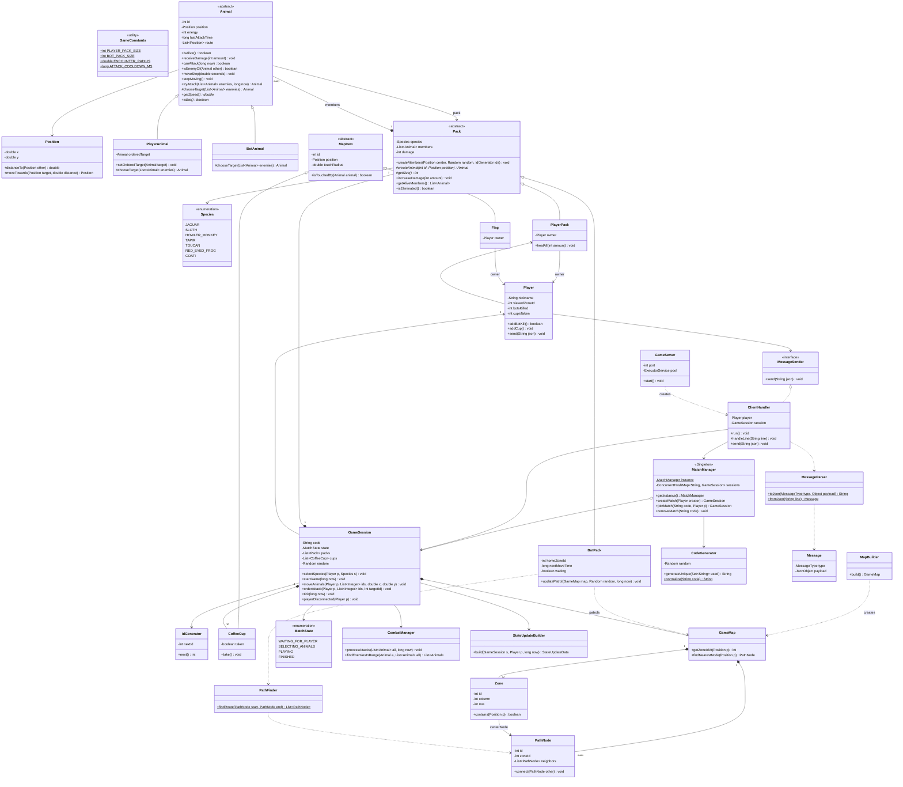

# Jungle Attack - Especificación del Servidor

Este documento es la especificación (spec) del proyecto **jungle-attack-server**.
Aquí explicamos qué paquetes y clases tiene el servidor, qué hace cada una,
qué cosas son `static`, dónde usamos herencia, interfaces y polimorfismo,
y qué patrones de diseño aplicamos.

El cliente (la interfaz del juego) tiene su propio repositorio y su propio spec.

---

## 1. Idea general

- El servidor es la **autoridad** del juego: él decide todo (movimiento, ataques, cafés, bonos y quién gana).
- Los clientes solo envían lo que el jugador **quiere hacer** (por ejemplo "mover estos animales aquí") y dibujan lo que el servidor les responde.
- Los dos clientes nunca se hablan entre ellos. Todo pasa por el servidor usando **sockets** y mensajes **JSON** (un JSON por línea).
- El servidor puede tener **N partidas** al mismo tiempo.

---

## 2. Decisiones que tomamos (interpretación de las reglas)

Usamos la interpretación de reglas del enunciado. Además, decidimos lo siguiente:

- **Forma del mapa**: 12 zonas acomodadas en una cuadrícula de **4 columnas x 3 filas**. Cada zona mide lo mismo que la pantalla del cliente (`ZONE_WIDTH` x `ZONE_HEIGHT`).
- **Caminos**: Cada zona tiene un **nodo central** y una "puerta" (nodo) hacia cada zona vecina. El centro se une con sus puertas, y cada puerta se une con la puerta de la zona vecina. Así todo el mapa es un **grafo de nodos** y los animales solo caminan por las líneas entre nodos.
- **Destino del movimiento**: Cuando el jugador hace clic, el servidor busca el **nodo más cercano** al clic y manda a los animales hasta ese nodo, siguiendo la ruta que encuentra **BFS**.
- **Bots**: Los bots **patrullan su propia zona**. El pack entero escoge al azar un nodo de su zona (el centro o una puerta), camina hasta ahí, espera `BOT_WAIT_MS` y escoge otro. Nunca salen de su zona. Si tienen un enemigo en rango, **se detienen a pelear**. Caminan un poco más lento que los animales del jugador (`BOT_SPEED`).
- **Cafés**: Los 10 cafés se ponen en **nodos puerta** escogidos al azar (sin repetir). Las puertas están sobre los caminos.
- **Bandera**: Cada jugador tiene su bandera en el centro de su zona inicial.
- **Pack sin animales**: Si a un jugador se le mueren todos sus animales, **pierde** y gana el otro.
- **Desconexión**: Si un jugador se desconecta en el lobby, la partida se borra. Si se desconecta eligiendo animal o jugando, **gana el otro jugador**.
- **Orden de ataque**: Un animal del jugador solo acepta la orden de atacar si el objetivo ya está dentro del rango. Si el objetivo muere o se sale del rango, deja de atacar.
- **Especies**: Las 7 especies son animales nativos de Costa Rica. **Los nombres de abajo son provisionales** y los vamos a cambiar cuando las escojamos.

---

## 3. Tecnologías

- **Java**: Java 17
- **Build**: Maven (`mvn test`, `mvn package`)
- **JSON**: Gson
- **Tests**: JUnit 5 (y Mockito si se ocupa)
- **Automatización**: GitHub Actions corriendo `mvn test` en cada push

---

## 4. Estructura del proyecto

```
jungle-attack-server/
├── pom.xml
├── README.md            (diagrama Mermaid y explicación)
├── SPEC.md              (este documento)
├── .github/workflows/tests.yml
└── src/
    ├── main/java/com/jungleattack/server/
    │   ├── util/        constantes, posición, generador de ids
    │   ├── model/       animales, packs, jugador, bandera, café, especies
    │   ├── map/         zonas, nodos, construcción del mapa, BFS
    │   ├── game/        la partida, el combate, el estado que se manda a cada jugador
    │   ├── lobby/       administrador de partidas y generador de códigos
    │   ├── protocol/    tipos de mensaje, clases de datos (payloads), parser JSON
    │   └── network/     servidor de sockets y manejo de cada cliente
    └── test/java/com/jungleattack/server/
        └── (mismos paquetes, un test por clase principal)
```

---

## 5. Paquetes y clases

Notación: `+` público, `-` privado, `#` protegido. *(static)* marca lo que es de la clase y no de cada objeto.

### 5.1 Paquete `util`

**Clase principal para tests:** `Position`

#### `GameConstants` (clase final, todo *static*)
Aquí van **todos** los números del juego, para no tener números "mágicos" regados en el código.
Tiene un constructor privado para que nadie pueda hacer `new GameConstants()`.

- `SERVER_PORT` = 5000: Puerto del servidor
- `PLAYERS_PER_MATCH` = 2: Jugadores por partida
- `CODE_LENGTH` = 4: Largo del código de partida
- `CODE_CHARACTERS` = `"ABCDEFGHIJKLMNOPQRSTUVWXYZ0123456789"`: Caracteres permitidos en el código
- `ZONE_COLUMNS` / `ZONE_ROWS` = 4 / 3: Cuadrícula de zonas (12 zonas)
- `ZONE_WIDTH` / `ZONE_HEIGHT` = 800 / 600: Tamaño de cada zona en píxeles
- `DOOR_MARGIN` = 40: Distancia de la puerta al borde de la zona
- `PLAYER_PACK_SIZE` = 10: Miembros del pack del jugador
- `PLAYER_START_ENERGY` = 20: Energía inicial de cada animal del jugador
- `MAX_PLAYER_ENERGY` = 20: Energía máxima del jugador
- `PLAYER_START_DAMAGE` = 2: Daño inicial del pack del jugador
- `BOT_PACK_SIZE` = 4: Miembros de un pack bot
- `BOT_START_ENERGY` = 10: Energía de cada bot
- `BOT_DAMAGE` = 1: Daño del pack bot
- `COFFEE_CUP_COUNT` = 10: Cantidad de cafés
- `COFFEE_DAMAGE_BONUS` = 1: Daño extra por café
- `BOTS_KILLED_FOR_BONUS` = 2: Cada cuántos bots muertos se da el bono
- `ENERGY_BONUS` = 1: Energía que da el bono
- `ANIMAL_SPEED` = 80.0: Velocidad de los animales del jugador (píxeles por segundo)
- `BOT_SPEED` = 50.0: Velocidad de los bots (píxeles por segundo)
- `BOT_WAIT_MS` = 3000: Tiempo que espera un pack bot antes de caminar a otro punto
- `BOT_SPREAD` = 15.0: Qué tan separados quedan los bots al llegar a un punto
- `ENCOUNTER_RADIUS` = 40.0: Distancia para "encontrarse" y atacar
- `PICKUP_RADIUS` = 20.0: Distancia para agarrar un café
- `FLAG_RADIUS` = 30.0: Distancia para tocar la bandera
- `SPAWN_SPREAD` = 30.0: Qué tan separados aparecen los animales del centro
- `ATTACK_COOLDOWN_MS` = 1000: 1 ataque por segundo
- `TICK_MS` = 50: Cada cuánto se actualiza el juego (20 veces por segundo)

#### `Position` (clase final, inmutable)
Una posición `(x, y)` en el mapa. Inmutable quiere decir que no cambia: si se mueve, se crea una nueva.

```
- double x
- double y
+ Position(double x, double y)
+ getX(): double
+ getY(): double
+ distanceTo(Position other): double             // distancia con Pitágoras
+ moveTowards(Position target, double distance): Position   // avanza "distance" hacia target
+ equals / hashCode / toString
```

#### `IdGenerator`
Da números de id únicos dentro de una partida (1, 2, 3...).

```
- int nextId
+ next(): int
```

---

### 5.2 Paquete `model`

**Clase principal para tests:** `Pack` (y `Animal`)

#### `Species` (enum)
Las 7 especies. **Provisionales:**

```
JAGUAR("Jaguar"), SLOTH("Perezoso"), HOWLER_MONKEY("Mono congo"),
TAPIR("Danta"), TOUCAN("Tucán"), RED_EYED_FROG("Rana calzonuda"), COATI("Pizote")

- String displayName
+ getDisplayName(): String
```

#### `Animal` (clase **abstracta**)
Lo que tienen en común todos los animales, de jugador y bots.

```
- int id
- Pack pack
- Position position
- int energy
- long lastAttackTime
- List<Position> route              // puntos que le faltan por caminar
+ Animal(int id, Pack pack, Position position, int energy)
+ getters (id, pack, position, energy)
+ isAlive(): boolean                // energy > 0
+ receiveDamage(int amount): void   // energy baja, nunca menos de 0
+ heal(int amount, int max): void   // energy sube, nunca más de max
+ canAttack(long now): boolean      // ya pasó ATTACK_COOLDOWN_MS desde el último ataque
+ isInRange(Animal other): boolean  // distancia <= ENCOUNTER_RADIUS
+ isEnemyOf(Animal other): boolean  // distinto pack y no son los dos bots
+ setRoute(List<Position> route): void
+ isMoving(): boolean
+ stopMoving(): void                // borra la ruta
+ moveStep(double seconds): void    // avanza getSpeed() * seconds siguiendo la ruta
+ abstract getSpeed(): double       // cada hijo dice qué tan rápido camina
+ tryAttack(List<Animal> enemiesInRange, long now): Animal   // MÉTODO PLANTILLA (final)
# abstract chooseTarget(List<Animal> enemiesInRange): Animal // cada hijo decide a quién atacar
+ abstract isBot(): boolean
```

`tryAttack` hace siempre los mismos pasos: revisa si está vivo y si ya puede atacar, **le pregunta al hijo** a quién atacar (`chooseTarget`), ataca y devuelve el animal que murió (o `null`).

#### `PlayerAnimal` (hereda de `Animal`)
```
- Animal orderedTarget              // el objetivo que el jugador le ordenó
+ PlayerAnimal(int id, PlayerPack pack, Position position)  // energía PLAYER_START_ENERGY
+ setOrderedTarget(Animal target): void
+ getOrderedTarget(): Animal
# chooseTarget(...): Animal          // solo ataca su objetivo ordenado; si murió o se salió del rango lo olvida
+ getSpeed(): ANIMAL_SPEED
+ isBot(): false
```

#### `BotAnimal` (hereda de `Animal`)
```
+ BotAnimal(int id, BotPack pack, Position position)  // energía BOT_START_ENERGY
# chooseTarget(...): Animal          // ataca solo al enemigo más cercano
+ getSpeed(): BOT_SPEED
+ isBot(): true
```

**Aquí está el polimorfismo:** el combate llama `animal.tryAttack(...)` sin saber si es bot o jugador, y cada uno elige su objetivo a su manera.

#### `Pack` (clase **abstracta**)
Una manada. El daño es del pack y lo comparten todos sus miembros.

```
- Species species
- List<Animal> members
- int damage
+ Pack(Species species, int startDamage)
+ getSpecies(), getDamage(), getMembers()
+ createMembers(Position center, Random random, IdGenerator ids): void
      // crea getSize() animales alrededor del centro usando createAnimal(...)
# abstract createAnimal(int id, Position position): Animal   // FACTORY METHOD
# abstract getSize(): int
+ increaseDamage(int amount): void
+ getAliveMembers(): List<Animal>
+ countDead(): int
+ isEliminated(): boolean           // todos muertos
+ findAnimalById(int id): Animal
+ abstract isBot(): boolean
```

#### `PlayerPack` (hereda de `Pack`)
```
- Player owner
+ PlayerPack(Species species, Player owner)   // daño PLAYER_START_DAMAGE
# createAnimal(...): new PlayerAnimal(...)
# getSize(): PLAYER_PACK_SIZE
+ healAll(int amount): void          // +amount a cada vivo, máximo MAX_PLAYER_ENERGY
+ getOwner(): Player
+ isBot(): false
```

#### `BotPack` (hereda de `Pack`)
```
- int homeZoneId                     // la zona que patrulla
- long nextMoveTime                  // cuándo puede volver a caminar
- boolean waiting                    // true mientras está esperando en un punto
+ BotPack(Species species, int homeZoneId)   // daño BOT_DAMAGE
# createAnimal(...): new BotAnimal(...)
# getSize(): BOT_PACK_SIZE
+ getHomeZoneId(): int
+ updatePatrol(GameMap map, Random random, long now): void   // ver 7.6
+ isBot(): true
```

#### `Player`
```
- String nickname
- MessageSender sender               // por donde se le mandan mensajes (interfaz)
- Species species
- PlayerPack pack
- Flag flag
- int startZoneId
- int viewedZoneId                   // la zona que está viendo
- int botsKilled
- int cupsTaken
+ Player(String nickname, MessageSender sender)
+ getters y setters necesarios
+ addBotKill(): boolean              // suma 1 y devuelve true si toca dar bono (múltiplo de 2)
+ addCup(): void
+ send(String json): void            // usa sender.send(json)
```

#### `MapItem` (clase **abstracta**)
Algo que está quieto en el mapa y que se puede "tocar".
```
- int id
- Position position
- double touchRadius
+ MapItem(int id, Position position, double touchRadius)
+ getId(), getPosition()
+ isTouchedBy(Animal animal): boolean   // distancia <= touchRadius
```

#### `Flag` (hereda de `MapItem`)
```
- Player owner
+ Flag(int id, Position position, Player owner)   // radio FLAG_RADIUS
+ getOwner(): Player
```

#### `CoffeeCup` (hereda de `MapItem`)
```
- boolean taken
+ CoffeeCup(int id, Position position)            // radio PICKUP_RADIUS
+ isTaken(): boolean
+ take(): void
```

---

### 5.3 Paquete `map`

**Clase principal para tests:** `PathFinder` (y `MapBuilder`)

#### `PathNode`
Un punto del camino. Los nodos unidos forman el grafo.
```
- int id
- Position position
- int zoneId
- List<PathNode> neighbors
+ connect(PathNode other): void      // une en los dos sentidos
+ getters
```

#### `Zone`
```
- int id
- int column
- int row
- PathNode centerNode
- List<PathNode> doorNodes
+ getMinX(), getMinY(): double
+ contains(Position p): boolean
+ getters
```

#### `GameMap`
```
- List<Zone> zones
- List<PathNode> nodes
+ getZone(int id): Zone
+ getZoneIdAt(Position p): int       // columna = x / ZONE_WIDTH, fila = y / ZONE_HEIGHT
+ findNearestNode(Position p): PathNode
+ getAllDoorNodes(): List<PathNode>
+ getNodes(), getZones()
```

#### `MapBuilder`
Construye el mapa de 4x3 con sus nodos y caminos.
```
+ build(): GameMap
- createZones(...)
- connectNeighbors(...)              // crea las puertas entre zonas vecinas
```

#### `PathFinder`
Busca la ruta con **BFS** (búsqueda en anchura).
```
+ findRoute(PathNode start, PathNode end): List<PathNode>   (static)
```

---

### 5.4 Paquete `game`

**Clase principal para tests:** `CombatManager` (y `GameSession`)

#### `MatchState` (enum)
`WAITING_FOR_PLAYER`, `SELECTING_ANIMALS`, `PLAYING`, `FINISHED`

#### `GameSession`
Una partida. Sus métodos son `synchronized` porque la usan varios hilos (ver sección 8).
```
- String code
- Player player1, player2
- MatchState state
- GameMap map
- List<Pack> packs                   // 2 de jugador + 5 bots
- List<CoffeeCup> cups
- Random random
- IdGenerator ids
- CombatManager combat
- StateUpdateBuilder stateBuilder
- ScheduledExecutorService loop
- long startTime, lastTickTime
- Player winner
+ GameSession(String code, Player creator, Random random)
+ addSecondPlayer(Player p): void
+ isFull(): boolean
+ selectSpecies(Player p, Species s): void       // lanza GameException si ya la tomaron
+ getAvailableSpecies(): List<Species>
+ startGame(long now): void          // mapa, zonas al azar, packs, banderas, cafés, arranca el loop
+ moveAnimals(Player p, List<Integer> ids, double x, double y): void
+ orderAttack(Player p, List<Integer> ids, int targetId): void
+ changeViewedZone(Player p, int zoneId): void
+ tick(long now): void               // una vuelta del juego
+ playerDisconnected(Player p): void
+ getOpponent(Player p): Player
+ getters (code, state, players, packs, cups, map, startTime)
- updateBots(long now)               // llama updatePatrol de cada BotPack
- moveAllAnimals(double seconds)     // los bots que están peleando no se mueven
- checkCoffeeCups()
- checkFlags()
- checkEliminatedPlayers()
- endGame(Player winner, String reason)
- sendStateUpdates(long now)
```

#### `CombatManager`
Toda la lógica de ataques, separada de la partida para poder probarla sola.
```
+ processAttacks(List<Animal> allAnimals, long now): void
+ findEnemiesInRange(Animal animal, List<Animal> all): List<Animal>
- registerKill(Animal attacker, Animal victim): void   // cuenta bots muertos y da el bono
```

#### `StateUpdateBuilder`
Arma el `STATE_UPDATE` de **un** jugador, solo con lo que ese jugador puede ver (niebla de guerra).
```
+ build(GameSession session, Player player, long now): StateUpdateData
- isZoneVisible(Player player, int zoneId): boolean   // tiene algún animal vivo ahí
- getZonesWithMyAnimals(Player player): List<Integer>
```

#### `GameException` (hereda de `Exception`)
Error de reglas del juego (por ejemplo "especie ya tomada"). Lleva un `ErrorCode`.

---

### 5.5 Paquete `lobby`

**Clase principal para tests:** `MatchManager` (y `CodeGenerator`)

#### `MatchManager` (**Singleton**)
Guarda todas las partidas activas.
```
- static MatchManager instance                     (static)
- ConcurrentHashMap<String, GameSession> sessions
- CodeGenerator codeGenerator
- MatchManager()                                   // privado
+ getInstance(): MatchManager                      (static)
+ createMatch(Player creator): GameSession
+ joinMatch(String code, Player player): GameSession   // lanza GameException
+ removeMatch(String code): void
+ getMatchCount(): int
+ clear(): void                                    // solo para tests
```

#### `CodeGenerator`
```
- Random random
+ CodeGenerator(Random random)
+ generate(): String                               // 4 caracteres al azar de CODE_CHARACTERS
+ generateUnique(Set<String> usedCodes): String    // repite hasta que no exista
+ normalize(String code): String  (static)         // pasa a mayúsculas y quita espacios
```

---

### 5.6 Paquete `protocol`

**Clase principal para tests:** `MessageParser`

#### `MessageType` (enum)
`CREATE_MATCH, JOIN_MATCH, SELECT_ANIMAL, MOVE_ANIMALS, ATTACK, VIEW_ZONE,
MATCH_CREATED, MATCH_JOINED, ERROR, ANIMAL_SELECTION, GAME_STARTED, STATE_UPDATE, GAME_OVER`

#### `ErrorCode` (enum)
`INVALID_NICKNAME, INVALID_CODE, MATCH_FULL, SPECIES_TAKEN, INVALID_ACTION`, cada uno con su mensaje de texto.

#### `Message`
El "sobre" de todos los mensajes.
```
- MessageType type
- JsonObject payload
+ getters
```

#### `MessageParser` (métodos *static*)
```
- static Gson gson                                 (static)
+ toJson(MessageType type, Object payload): String (static)
+ fromJson(String line): Message                   (static)
+ readPayload(Message msg, Class<T> clazz): T      (static)
```

#### Clases de datos (payloads)
Son clases simples con atributos privados, constructor y getters. **No tienen lógica.**
El cliente tiene una copia igual de estas clases.

**Cliente → Servidor**

- `CreateMatchRequest`: nickname
- `JoinMatchRequest`: nickname, code
- `SelectAnimalRequest`: species
- `MoveAnimalsRequest`: animalIds, targetX, targetY
- `AttackRequest`: animalIds, targetId
- `ViewZoneRequest`: zoneId

**Servidor → Cliente**

- `MatchCreatedData`: code
- `MatchJoinedData`: code, opponentNickname
- `ErrorData`: errorCode, message
- `AnimalSelectionData`: availableSpecies, mySpecies, opponentSpecies
- `GameStartedData`: map (`MapData`), myZoneId, mySpecies, opponentNickname
- `StateUpdateData`: viewedZoneId, zonesWithMyAnimals, myAnimals, visibleAnimals, visibleCups, visibleFlags, myDamage, myCups, myBotsKilled, elapsedSeconds, events
- `GameOverData`: winnerNickname, reason, summary (`SummaryData`)

**Clases de apoyo**

- `AnimalInfo`: id, species, x, y, energy, bot, mine
- `CupInfo`: id, x, y
- `FlagInfo`: id, x, y, mine
- `MapData`: columns, rows, zoneWidth, zoneHeight, nodes (`NodeInfo`), paths (`PathInfo`)
- `NodeInfo`: id, x, y, zoneId
- `PathInfo`: fromNodeId, toNodeId
- `SummaryData`: durationSeconds, players (`PlayerSummary`), packs (`PackSummary`)
- `PlayerSummary`: nickname, species, botsKilled, cupsTaken
- `PackSummary`: species, bot, deadAnimals, totalAnimals

---

### 5.7 Paquete `network`

**Clase principal para tests:** `ClientHandler`

#### `MessageSender` (**interfaz**)
```
+ send(String json): void
```
La usamos para que `Player` y `GameSession` no dependan de un socket real. En los tests usamos un `MessageSender` falso que guarda los mensajes en una lista.

#### `ServerMain`
Tiene el `main`. Solo crea el `GameServer` y lo arranca.

#### `GameServer`
```
- int port
- ExecutorService pool
+ GameServer(int port)
+ start(): void        // ServerSocket, acepta clientes y crea un ClientHandler por cada uno
```

#### `ClientHandler` (implementa `Runnable` y `MessageSender`)
Atiende a **un** cliente en su propio hilo.
```
- Socket socket
- BufferedReader in
- PrintWriter out
- Player player
- GameSession session
+ ClientHandler(Socket socket)
+ ClientHandler(BufferedReader in, PrintWriter out)   // para tests sin red
+ run(): void                       // lee línea por línea hasta que se desconecte
+ handleLine(String line): void     // convierte a Message y hace switch por tipo
+ send(String json): void           // synchronized
- handleCreateMatch(...), handleJoinMatch(...), handleSelectAnimal(...),
  handleMove(...), handleAttack(...), handleViewZone(...)
- sendError(ErrorCode code): void
- disconnect(): void                // avisa a la partida y cierra el socket
```

---

## 6. Resumen de POO y patrones

### `static`
- `GameConstants`: todas sus constantes.
- `MatchManager.instance` y `MatchManager.getInstance()`.
- `MessageParser`: el `Gson` y todos sus métodos.
- `PathFinder.findRoute(...)`.
- `CodeGenerator.normalize(...)`.

### Herencia
- `Animal` → `PlayerAnimal`, `BotAnimal`
- `Pack` → `PlayerPack`, `BotPack`
- `MapItem` → `Flag`, `CoffeeCup`
- `Exception` → `GameException`

### Interfaces
- `MessageSender` (la implementa `ClientHandler`, y en los tests un sender falso)
- `Runnable` (la implementa `ClientHandler`)

### Polimorfismo
- `Animal.chooseTarget(...)`: el bot ataca al más cercano y el animal del jugador solo ataca al objetivo que se le ordenó.
- `Pack.createAnimal(...)`: cada pack crea su propio tipo de animal.
- `Animal.getSpeed()`: cada tipo de animal camina a su propia velocidad.
- `isBot()` en `Animal` y en `Pack`.
- `MapItem.isTouchedBy(...)` sirve igual para banderas y cafés.

### Patrones de diseño

- **Singleton**
  - Clases: `MatchManager`
  - Por qué: Solo debe existir un administrador de partidas en el servidor.
- **Factory Method**
  - Clases: `Pack` (creador), `PlayerPack` / `BotPack` (creadores concretos), `PlayerAnimal` / `BotAnimal` (productos)
  - Por qué: Cada pack sabe qué tipo de animal crear y `createMembers` no tiene que preguntar con `if`.
- **Template Method**
  - Clases: `Animal.tryAttack` (plantilla), `chooseTarget` (paso que cambia)
  - Por qué: Los pasos de un ataque son siempre iguales y solo cambia a quién se ataca.

(Los patrones **Observer** y **MVC** van en el cliente.)

---

## 7. Algoritmos

### 7.1 BFS para la ruta (`PathFinder`)
1. Meter el nodo inicial en una cola (`Queue`) y marcarlo como visitado.
2. Mientras la cola no esté vacía, sacar un nodo. Si es el destino, terminar.
3. Por cada vecino no visitado: marcarlo, guardar de dónde vino (`previous.put(vecino, actual)`) y meterlo a la cola.
4. Para armar la ruta, se va hacia atrás desde el destino usando `previous` y al final se le da vuelta a la lista.

BFS encuentra la ruta con **menos saltos**. Como todos los caminos son parecidos, eso es suficiente.

### 7.2 Movimiento a velocidad constante (`Animal.moveStep`)
```
distancia = ANIMAL_SPEED * seconds
mientras distancia > 0 y la ruta no esté vacía:
    siguiente = primer punto de la ruta
    d = distancia hasta siguiente
    si d <= distancia: llegar al punto, quitarlo de la ruta, distancia -= d
    si no: avanzar "distancia" hacia el punto, distancia = 0
```
`seconds` es el tiempo real desde el tick anterior (deltaTime). Así la velocidad no cambia aunque un tick llegue tarde.
`ANIMAL_SPEED` aquí es en realidad `getSpeed()`, porque cada tipo de animal da su propia velocidad (polimorfismo).

### 7.3 Un tick del juego (`GameSession.tick`)
1. Calcular `seconds = (now - lastTickTime) / 1000.0`.
2. Actualizar la patrulla de los bots (`updateBots`).
3. Mover todos los animales vivos (`moveStep`). Si un bot tiene un enemigo en rango, se llama `stopMoving()` y no camina.
4. Revisar cafés: si un animal de jugador toca uno que no se ha tomado, se toma, el pack recibe +1 de daño y el jugador suma 1 café.
5. Combate: `combat.processAttacks(todosLosAnimales, now)`.
6. Revisar banderas: si un animal toca la bandera **del rival**, gana su dueño.
7. Revisar si a algún jugador se le murieron todos los animales.
8. Si se terminó, `endGame(...)`. Si no, mandar un `STATE_UPDATE` a cada jugador.

### 7.4 Combate (`CombatManager.processAttacks`)
```
por cada animal vivo:
    enemigos = findEnemiesInRange(animal, todos)
    muerto = animal.tryAttack(enemigos, now)
    si muerto != null: registerKill(animal, muerto)
```
`registerKill`: si el atacante es de un jugador y el muerto es un bot, `player.addBotKill()`. Si eso devuelve `true` (llegó a un múltiplo de 2), `pack.healAll(ENERGY_BONUS)`.

Ejemplo del enunciado: 1 animal del jugador (20 de energía) contra 4 bots (daño 1 cada uno) recibe 4 de daño por segundo y muere en 5 segundos. Él hace daño 2 por segundo, así que mata a un bot (10 de energía) en el segundo 5.

### 7.5 Inicio de la partida (`GameSession.startGame`)
1. Construir el mapa con `MapBuilder`.
2. Hacer una lista de las 12 zonas, revolverla con `Collections.shuffle(lista, random)` y tomar las primeras 7: las 2 primeras para los jugadores y las otras 5 para los bots.
3. Crear los packs y sus miembros alrededor del centro de su zona. Cada `BotPack` recibe su zona como `homeZoneId`.
4. Poner la bandera de cada jugador en el centro de su zona.
5. Escoger 10 nodos puerta al azar y poner un café en cada uno.
6. Mandar `GAME_STARTED` a los dos jugadores y arrancar el loop cada `TICK_MS`.

Usamos el `Random` que recibe el constructor, así en los tests podemos usar una **semilla fija** y siempre sale lo mismo.

### 7.6 Patrulla de los bots (`BotPack.updatePatrol`)
```
si algún bot vivo del pack todavía está caminando: no hacer nada
si no está esperando (acaba de llegar):
    waiting = true
    nextMoveTime = now + BOT_WAIT_MS
si está esperando y now >= nextMoveTime:
    destino = un nodo al azar de su zona (centro o puertas), distinto al más cercano
    por cada bot vivo:
        ruta = PathFinder.findRoute(nodo más cercano al bot, destino)
        al último punto se le suma un corrimiento al azar de hasta BOT_SPREAD
        bot.setRoute(ruta)
    waiting = false
```
- El pack camina **junto**, así que al encontrárselo siguen atacando los 4 a la vez, como en el ejemplo del enunciado.
- Los destinos siempre son de su propia zona, así que el pack nunca sale de ella.
- El corrimiento al final es para que los 4 bots no queden dibujados uno encima del otro.
- Como usa el `Random` de la partida, en los tests el movimiento es predecible.

---

## 8. Hilos

- **Hilo principal**: `GameServer` acepta conexiones.
- **Un hilo por cliente**: `ClientHandler` lee los mensajes de ese cliente.
- **Un hilo por partida**: El `ScheduledExecutorService` llama `tick()` cada `TICK_MS`.

Como el hilo del cliente y el hilo de la partida tocan la misma `GameSession`, sus métodos públicos son **`synchronized`**. Así solo un hilo a la vez puede cambiarla.
`ClientHandler.send()` también es `synchronized` para que dos mensajes no se mezclen en la misma línea.
Los sockets se cierran con `try-with-resources` o en un `finally`.

---

## 9. Protocolo de mensajes

Un JSON por línea, en UTF-8, siempre con `type` y `payload`.

```json
{ "type": "CREATE_MATCH", "payload": { "nickname": "Ana" } }
{ "type": "MATCH_CREATED", "payload": { "code": "A7K2" } }
{ "type": "JOIN_MATCH", "payload": { "nickname": "Luis", "code": "a7k2" } }
{ "type": "SELECT_ANIMAL", "payload": { "species": "JAGUAR" } }
{ "type": "MOVE_ANIMALS", "payload": { "animalIds": [3, 4, 7], "targetX": 812, "targetY": 344 } }
{ "type": "ATTACK", "payload": { "animalIds": [3, 4], "targetId": 41 } }
{ "type": "VIEW_ZONE", "payload": { "zoneId": 5 } }
{ "type": "ERROR", "payload": { "errorCode": "MATCH_FULL", "message": "La partida ya está llena" } }
```

Flujo normal:
1. A manda `CREATE_MATCH` y recibe `MATCH_CREATED` con el código.
2. B manda `JOIN_MATCH` y los dos reciben `MATCH_JOINED`, luego `ANIMAL_SELECTION`.
3. Cada uno manda `SELECT_ANIMAL`, y los dos reciben `ANIMAL_SELECTION` actualizado.
4. Cuando los dos eligieron, los dos reciben `GAME_STARTED`.
5. Durante el juego llega `STATE_UPDATE` unas 20 veces por segundo, y los clientes mandan `MOVE_ANIMALS`, `ATTACK` y `VIEW_ZONE`.
6. Al final, `GAME_OVER` con el resumen.

---

## 10. Plan de pruebas (JUnit 5)

- `PositionTest` (paquete `util`): Distancia, `moveTowards` sin pasarse del destino.
- `AnimalTest` (paquete `model`): Daño, muerte en 0, energía nunca negativa, cooldown de 1 segundo, el bot elige al más cercano, el animal del jugador olvida el objetivo si se sale del rango.
- `PackTest` (paquete `model`): Tamaños 10/4, energías 20/10, daños 2/1, el café suma +1 a todo el pack, `healAll` no pasa de 20.
- `BotPackTest` (paquete `model`): La patrulla espera `BOT_WAIT_MS`, escoge un destino de su zona y nunca sale de ella.
- `PathFinderTest` (paquete `map`): Ruta entre zonas vecinas, entre esquinas opuestas, ruta al mismo nodo.
- `MapBuilderTest` (paquete `map`): Hay 12 zonas y todas están conectadas.
- `CombatManagerTest` (paquete `game`): El ejemplo del enunciado (muere en 5 s, mata un bot en 5 s), los bots no se atacan entre ellos, bono cada 2 bots.
- `GameSessionTest` (paquete `game`): Especie repetida da error, quedan 5 bots, 7 zonas distintas, café se toma una sola vez, tocar la bandera rival termina la partida.
- `CodeGeneratorTest` (paquete `lobby`): Largo 4, solo caracteres válidos, códigos únicos, mayúsculas/minúsculas iguales.
- `MatchManagerTest` (paquete `lobby`): Código inválido, partida llena, se borra al terminar.
- `MessageParserTest` (paquete `protocol`): Ida y vuelta (round trip) de cada tipo de mensaje.
- `ClientHandlerTest` (paquete `network`): Mandar `CREATE_MATCH` por un `StringReader` y revisar que responde `MATCH_CREATED`.

GitHub Actions corre `mvn test` en cada push.

---

## 11. Diagrama de clases (Mermaid)

Las clases de datos del paquete `protocol` (payloads) no salen en el diagrama para que no quede tan grande.



---

## 12. Pendientes

- [ ] Escoger las 7 especies definitivas (nativas de Costa Rica) y cambiar el enum `Species`.
- [ ] Hacer el spec del cliente.
- [ ] Revisar este spec con el profesor.
