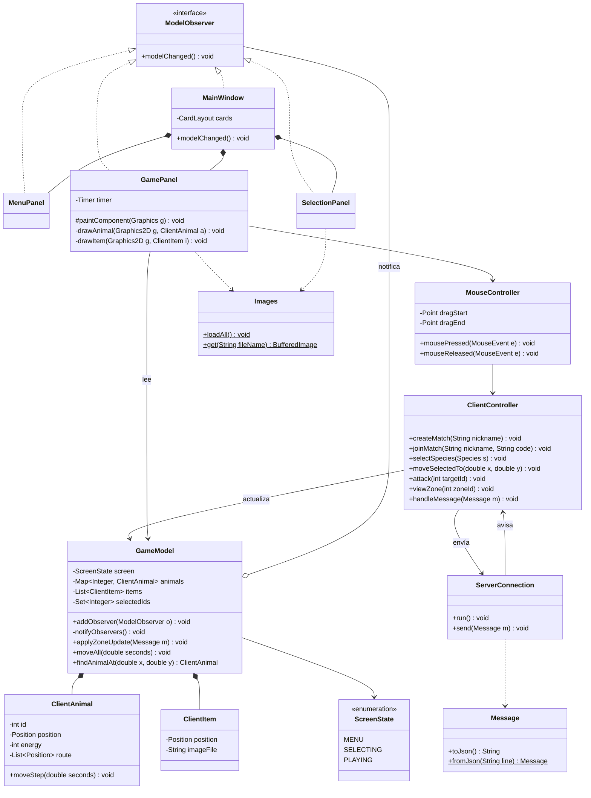

# Jungle Attack - Spec del Cliente

Este documento describe el proyecto **jungle-attack-client**, que es el juego que usa cada jugador: sus pantallas, cómo se juega con el mouse, sus paquetes y clases, y cómo lo vamos a probar.

Los mensajes que se intercambian con el servidor están en la sección 3 de `Spec-admin.md`.

---

## 1. Qué hace el cliente

- **No decide nada del juego.** No calcula daño, ni rutas, ni quién gana. Eso lo hace el servidor.
- Hace cuatro cosas:
  1. **Escucha** los mensajes del servidor y guarda lo que recibe en el modelo.
  2. **Mueve** a los animales en pantalla. Cada `ZONE_UPDATE` dice dónde está cada animal y qué ruta le falta, y el cliente lo va avanzando a su velocidad (es el mismo cálculo que usa el servidor).
  3. **Dibuja** lo que hay en el modelo.
  4. **Convierte los clics** en mensajes para el servidor.
- Está organizado con **MVC** (Modelo, Vista, Controlador) y **Observer**.

---

## 2. Cómo se juega

### Pantallas

- **Menú:** campos de servidor (por defecto `localhost`), nickname y código, más los botones "Crear partida" y "Unirse". Al crear una partida, en esa misma pantalla aparece el código y el mensaje "Esperando al otro jugador...".
- **Selección:** 7 botones, uno por especie, cada uno con su imagen. Las especies que ya tomó el rival salen deshabilitadas.
- **Juego:** a la izquierda, la zona que el jugador está viendo (800 x 600). A la derecha, un panel con sus datos y el minimapa.
- **Fin:** una ventana (`JOptionPane`) con el ganador y el resumen. Al cerrarla, el jugador vuelve al menú.

### Mouse

- **Clic izquierdo sobre un animal mío:** lo selecciona.
- **Arrastrar con el clic izquierdo:** selecciona todos mis animales que queden dentro del rectángulo.
- **Clic izquierdo en un lugar vacío:** quita la selección.
- **Clic derecho sobre un enemigo:** los animales seleccionados lo atacan (`ATTACK`).
- **Clic derecho en un lugar vacío:** los animales seleccionados caminan hacia ahí (`MOVE_ANIMALS`).
- **Clic en una zona del minimapa:** el jugador pasa a ver esa zona (`VIEW_ZONE`). Solo funciona en las zonas donde tiene animales vivos.

### Panel de datos (a la derecha)

- Especie, daño actual del pack, cafés tomados, bots eliminados, animales vivos, cuántos animales hay seleccionados y el tiempo de la partida.
- Los últimos 5 eventos, por ejemplo "Tu pack tomó un café".
- **Minimapa** de 4 x 3 cuadritos:
  - la zona que se está viendo tiene un borde grueso;
  - las zonas donde el jugador tiene animales salen de color;
  - las demás salen grises.

---

## 3. Tecnologías

- **Java 17** (la misma versión que el servidor)
- **Maven**
- **Swing** (`JFrame`, `JPanel`, `CardLayout`)
- **JSVG** para cargar las imágenes SVG
- **Gson** para JSON
- **JUnit 5** para las pruebas
- **GitHub Actions** corre `mvn test` en cada push

### Imágenes (SVG, en `src/main/resources/images/`)

- **Especies:** `jaguar.svg`, `sloth.svg`, `howler_monkey.svg`, `tapir.svg`, `toucan.svg`, `red_eyed_frog.svg`, `coati.svg`
- **Objetos:** `coffee.svg`, `flag_red.svg`, `flag_blue.svg`
- **Fondo:** `grass.svg`

Los caminos se dibujan con líneas, no con imágenes.

---

## 4. Paquetes

```
src/main/java/com/jungleattack/client/
├── util/        ClientConstants, Position, Images
├── protocol/    MessageType, Message           (copia del servidor)
├── network/     ServerConnection
├── model/       ScreenState, ModelObserver, GameModel, ClientAnimal, ClientItem, Species
├── controller/  ClientController, MouseController
└── view/        MainWindow, MenuPanel, SelectionPanel, GamePanel
```

Son **18 clases**. Las pruebas van en `src/test/java` con los mismos paquetes.

---

## 5. Clases

Notación: `+` público, `-` privado, `#` protegido.

### 5.1 `util`

**`ClientConstants`** (clase final, todo `static`, constructor privado)

- **Red:** `DEFAULT_HOST = "localhost"`, `SERVER_PORT = 5000`
- **Ventana:** `WINDOW_TITLE = "Jungle Attack"`, `ZONE_WIDTH = 800`, `ZONE_HEIGHT = 600`, `HUD_WIDTH = 220`
- **Dibujo:** `FPS = 30`, `FRAME_MS = 33`, `ANIMAL_SIZE = 32`, `ITEM_SIZE = 24`, `PATH_WIDTH = 14`, `MINIMAP_CELL = 40`
- **Barra de energía:** `ENERGY_BAR_WIDTH = 30`, `MAX_ENERGY = 20`
- **Mouse:** `CLICK_RADIUS = 18`, `MIN_DRAG = 5` (si el mouse se movió menos de eso, cuenta como un clic y no como un arrastre)
- **Eventos:** `MAX_EVENTS = 5`
- **Colores:** `MY_COLOR`, `ENEMY_COLOR`, `BOT_COLOR`, `SELECTION_COLOR`, `PATH_COLOR`
- **Imágenes:** `IMAGE_FILES` (la lista de los archivos SVG)

**`Position`**: la misma clase mutable del servidor (`x`, `y`, `distanceTo`, `moveTowards`).

**`Images`**: carga cada SVG **una sola vez** al iniciar el programa y lo guarda en un mapa, para no leer el archivo en cada cuadro.
```
- static Map<String, BufferedImage> images
+ static loadAll()                     // al iniciar: lee cada archivo de IMAGE_FILES con JSVG
+ static get(String fileName): BufferedImage
```

### 5.2 `protocol`

**`MessageType`** y **`Message`**: son **copias iguales** de las del servidor. Si se cambia algo en un repositorio, hay que cambiarlo también en el otro.

### 5.3 `network`

**`ServerConnection`** (implementa `Runnable`)
```
- Socket socket
- BufferedReader in
- PrintWriter out
- ClientController controller
+ ServerConnection(String host, int port, ClientController controller)       // lanza IOException
+ ServerConnection(BufferedReader in, PrintWriter out, ClientController c)   // para tests
+ start()                      // crea el hilo de red
+ run()                        // lee cada línea y llama a controller.onMessage(...)
+ send(Message message)        // synchronized
+ close()
```

### 5.4 `model`

**`ScreenState`** (enum): `MENU`, `SELECTING`, `PLAYING`

**`Species`** (enum): la misma del servidor, con su nombre y su archivo de imagen.

**`ModelObserver`** (interfaz): `modelChanged()`

**`ClientAnimal`**: un animal tal como lo conoce el cliente.
```
- int id
- Species species
- Position position
- int energy
- boolean mine, bot
- double speed
- List<Position> route
+ moveStep(double seconds)      // el mismo cálculo que Animal.moveStep del servidor
+ getters
```

**`ClientItem`**: un café o una bandera. Tiene `id`, `position` e `imageFile`.

**`GameModel`**: todo lo que el cliente sabe de la partida. Es el **sujeto** del Observer.
```
- List<ModelObserver> observers
- ScreenState screen
- String nickname, matchCode, opponent
- List<Species> availableSpecies
- Species mySpecies, opponentSpecies
- List<double[]> paths                       // líneas de los caminos (llegan en GAME_STARTED)
- Map<Integer, ClientAnimal> animals
- List<ClientItem> items
- int viewedZoneId
- List<Integer> myZones
- int myDamage, myCups, myBotsKilled, seconds
- List<String> events
- Set<Integer> selectedIds

+ addObserver(ModelObserver o)
- notifyObservers()
+ setScreen(...), setMatchCode(...), setSpeciesSelection(...)
+ startGame(Message m)                       // guarda los caminos y la zona inicial
+ applyZoneUpdate(Message m)                 // reemplaza animales e items y quita de la selección a los que ya no están
+ moveAll(double seconds)                    // llama moveStep() a cada animal
+ findAnimalAt(double x, double y): ClientAnimal    // el más cercano al clic, dentro de CLICK_RADIUS
+ selectOnly(int id), selectInside(double x1, double y1, double x2, double y2), clearSelection()
+ getZoneMinX(), getZoneMinY()               // la esquina de la zona que se está viendo
+ reset()                                    // para volver al menú
+ getters
```

### 5.5 `controller`

**`ClientController`**: el puente entre la red, el modelo y lo que hace el jugador.
```
- GameModel model
- ServerConnection connection

// Acciones del jugador (las llaman las vistas y el MouseController)
+ connect(String host)
+ createMatch(String nickname), joinMatch(String nickname, String code)
+ selectSpecies(Species s)
+ moveSelectedTo(double x, double y)    // si no hay nada seleccionado, no manda nada
+ attack(int targetId)                  // si no hay nada seleccionado, no manda nada
+ viewZone(int zoneId)

// Lo que llega del servidor
+ onMessage(Message m)                  // se llama desde el hilo de red: SwingUtilities.invokeLater(() -> handleMessage(m))
+ onDisconnected()
+ handleMessage(Message m)              // un switch según el tipo de mensaje (ver 6.2)
```

**`MouseController`** (hereda de `MouseAdapter`): convierte los eventos del mouse en acciones del controlador.
```
- GameModel model
- ClientController controller
- Point dragStart, dragEnd
+ mousePressed(MouseEvent e), mouseDragged(MouseEvent e), mouseReleased(MouseEvent e)
+ getDragRectangle(): Rectangle     // para que GamePanel lo dibuje (null si no se está arrastrando)
```
Para pasar un punto de la pantalla al mapa: `x del mapa = x en pantalla + model.getZoneMinX()` (y lo mismo para `y`). Si el clic cae en el minimapa, se calcula qué zona es y se llama a `viewZone()`.

### 5.6 `view`

**`MainWindow`** (hereda de `JFrame`, implementa `ModelObserver`)
- Tiene el `main`: carga las imágenes, crea el modelo, el controlador y la ventana.
- Usa un `CardLayout` para mostrar `MenuPanel`, `SelectionPanel` o `GamePanel` según `model.getScreen()`.
- Muestra los errores y el resumen final con `JOptionPane`.

**`MenuPanel`** (hereda de `JPanel`, implementa `ModelObserver`)
- Tiene los campos y botones del menú.
- Cuando hay código de partida, muestra "Código: A7K2. Esperando al otro jugador...".

**`SelectionPanel`** (hereda de `JPanel`, implementa `ModelObserver`)
- Tiene los 7 botones de especie.
- En `modelChanged()` deshabilita las especies que ya no están disponibles y muestra lo que escogió cada jugador.

**`GamePanel`** (hereda de `JPanel`, implementa `ModelObserver`)
- Un `javax.swing.Timer` lo llama cada 33 ms: hace `model.moveAll(seconds)` y luego `repaint()`.
```
- GameModel model
- MouseController mouse
- Timer timer
- long lastFrameTime
# paintComponent(Graphics g)    // fondo → caminos → items → animales → rectángulo de selección → panel de datos
- drawPaths(Graphics2D g)
- drawItem(Graphics2D g, ClientItem item)
- drawAnimal(Graphics2D g, ClientAnimal a)    // imagen, barra de energía, borde de color y círculo si está seleccionado
- drawHud(Graphics2D g)
- drawMiniMap(Graphics2D g)
```
Para dibujar un item o un animal se usa `Images.get(...)` con su archivo de imagen. No importa si es un café, una bandera o una especie.

---

## 6. Funcionamiento

### 6.1 Hilos

- **Hilo principal:** arranca el programa y crea la ventana con `SwingUtilities.invokeLater`.
- **Hilo de red:** `ServerConnection.run()` lee los mensajes del servidor. **Nunca toca Swing.**
- **Hilo de Swing (EDT):** dibuja, atiende el mouse, recibe el `Timer` y actualiza el modelo.

Cuando llega un mensaje, el hilo de red lo pasa con `SwingUtilities.invokeLater(...)`. Así el modelo solo se cambia desde el hilo de Swing y no hace falta `synchronized` en el modelo.

### 6.2 Qué hace con cada mensaje (`ClientController.handleMessage`)

- `MATCH_CREATED`: guarda el código. El menú muestra "Esperando...".
- `MATCH_JOINED`: guarda el nombre del rival y pasa a `SELECTING`.
- `ANIMAL_SELECTION`: actualiza las especies disponibles y lo que escogió cada jugador.
- `GAME_STARTED`: guarda los caminos y la zona inicial, y pasa a `PLAYING`.
- `ZONE_UPDATE`: `model.applyZoneUpdate(...)`
- `GAME_OVER`: muestra el resumen y vuelve al `MENU`.
- `ERROR`: muestra el mensaje en un `JOptionPane`.
- Desconexión: muestra "Se perdió la conexión con el servidor" y vuelve al menú.

### 6.3 Movimiento en pantalla

1. Llega un `ZONE_UPDATE`. Cada animal trae su posición, su velocidad y la ruta que le falta.
2. Cada 33 ms, `GamePanel` llama a `model.moveAll(seconds)`, y cada animal avanza `speed * seconds` por su ruta.
3. Cuando llega el siguiente `ZONE_UPDATE`, las posiciones se reemplazan por las del servidor. Si hubo alguna diferencia, se corrige ahí, y como el servidor manda un chequeo al menos cada segundo, la diferencia nunca dura más que eso.

### 6.4 Selección con rectángulo

1. En `mousePressed` se guarda el punto donde empezó.
2. En `mouseDragged` se guarda el punto actual, y `GamePanel` dibuja el rectángulo.
3. En `mouseReleased`:
   - si el mouse se movió menos de `MIN_DRAG`, se trata como un clic normal;
   - si no, se llama a `model.selectInside(...)`.

---

## 7. POO y patrones

- **`static`:** las constantes de `ClientConstants`, los métodos de `Images` y `Message.fromJson()`.
- **Herencia:** `MainWindow` hereda de `JFrame`; `MenuPanel`, `SelectionPanel` y `GamePanel` heredan de `JPanel`; `MouseController` hereda de `MouseAdapter`.
- **Interfaces:** `ModelObserver` (la implementan `MainWindow` y los tres paneles) y `Runnable` (la implementa `ServerConnection`).
- **Polimorfismo:**
  - El modelo llama a `modelChanged()` en todos sus observadores sin saber si son la ventana o un panel. Cada uno reacciona a su manera.
  - `drawItem()` dibuja cualquier item con su `imageFile`, sin preguntar qué tipo es.
- **Patrones:**
  - **MVC:**
    - Modelo: `GameModel`, `ClientAnimal` y `ClientItem`.
    - Vista: `MainWindow` y los paneles.
    - Controlador: `ClientController` y `MouseController`.
    - La vista no tiene lógica del juego.
  - **Observer:** `GameModel` es el sujeto y `ModelObserver` es el observador. Cuando cambia el modelo, las vistas se enteran solas.

---

## 8. Pruebas (JUnit 5)

Hay al menos un test por paquete, todos sin red real y sin abrir ventanas:

- **`PositionTest`** (util): la distancia y que `moveTowards` no se pase del destino.
- **`MessageTest`** (protocol): ida y vuelta (`toJson` → `fromJson`) de cada tipo de mensaje.
- **`ServerConnectionTest`** (network):
  - con un `StringWriter`, que `send` escribe una línea JSON correcta;
  - con un `StringReader`, que cada línea llega al controlador.
- **`ClientAnimalTest`** (model): que `moveStep` avanza a velocidad constante y se detiene al final de la ruta.
- **`GameModelTest`** (model):
  - que los observadores reciben el aviso;
  - que `applyZoneUpdate` reemplaza los animales;
  - que `findAnimalAt` encuentra el animal correcto;
  - que los animales que ya no están salen de la selección.
- **`ClientControllerTest`** (controller):
  - que `moveSelectedTo` manda `MOVE_ANIMALS` con los ids correctos;
  - que no manda nada si no hay selección;
  - que `MATCH_JOINED` cambia la pantalla a `SELECTING`.
- **`SelectionPanelTest`** (view): que al aplicar un `ANIMAL_SELECTION`, el botón de la especie que ya tomó el rival queda deshabilitado. Se crea el panel sin mostrar la ventana.

GitHub Actions corre `mvn test` en cada push.

---

## 9. Diagrama de clases


