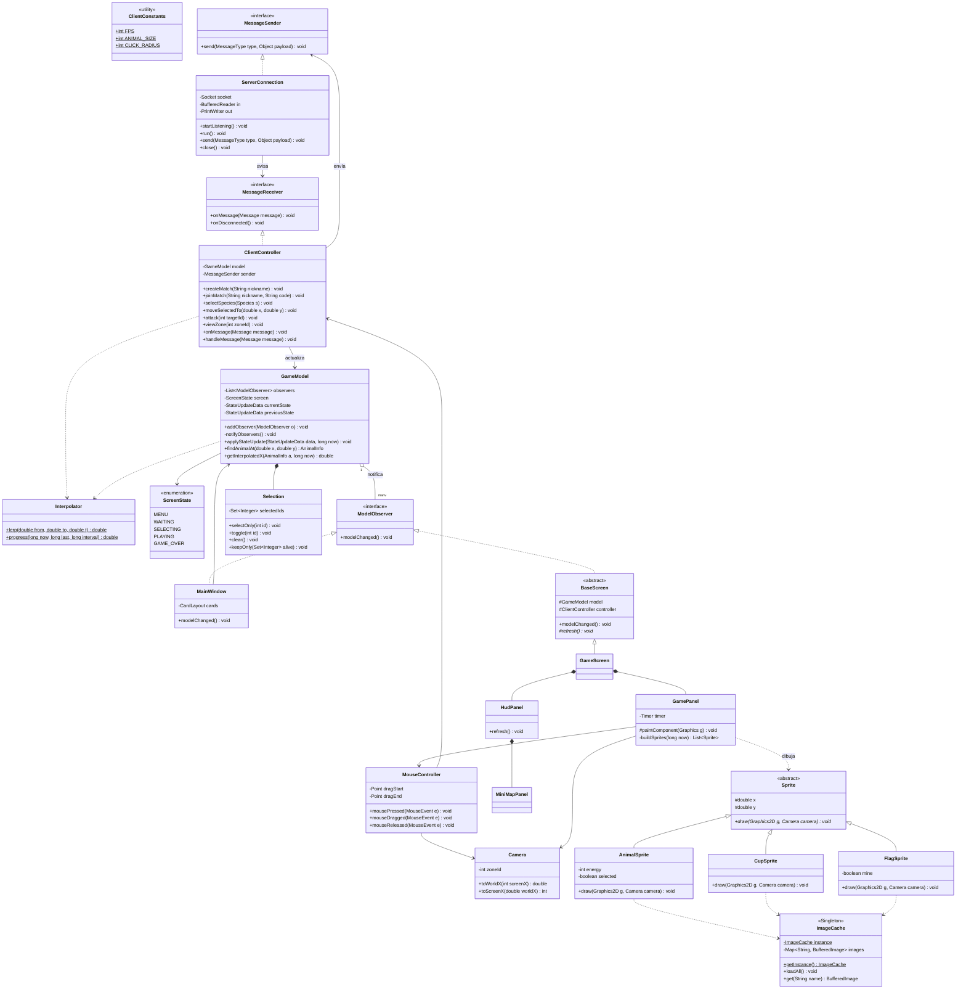

# Jungle Attack - Especificación del Cliente

Este documento es la especificación (spec) del proyecto **jungle-attack-client**, la aplicación que usa cada jugador para jugar.
Aquí explicamos qué paquetes y clases tiene el cliente, qué hace cada una, qué cosas son `static`,
dónde usamos herencia, interfaces y polimorfismo, y qué patrones de diseño aplicamos.

El servidor tiene su propio repositorio y su propio spec.

---

## 1. Idea general

- El cliente **no tiene lógica del juego**. No calcula daño, ni rutas, ni quién gana. Eso lo hace el servidor.
- El cliente hace tres cosas:
  1. **Escucha** los mensajes del servidor y guarda lo que recibe en el modelo.
  2. **Dibuja** lo que hay en el modelo.
  3. **Convierte los clics del mouse** en mensajes para el servidor (por ejemplo "mover estos animales aquí").
- Está organizado con **MVC** (Modelo - Vista - Controlador) y **Observer**.
- Se usa principalmente con el **mouse**.

---

## 2. Cómo se juega con el mouse

- **Clic izquierdo sobre un animal mío**: Lo selecciona (y quita la selección anterior).
- **Shift + clic izquierdo sobre un animal mío**: Lo agrega o lo quita de la selección.
- **Arrastrar con clic izquierdo**: Dibuja un rectángulo y selecciona todos mis animales que quedan adentro.
- **Clic izquierdo en un lugar vacío**: Quita la selección.
- **Clic derecho sobre un enemigo (bot o rival)**: Los animales seleccionados lo atacan (`ATTACK`).
- **Clic derecho en un lugar vacío**: Los animales seleccionados caminan hacia ahí (`MOVE_ANIMALS`).
- **Clic en una zona del minimapa**: Cambia la zona que estoy viendo (`VIEW_ZONE`). Solo funciona en zonas donde tengo animales vivos.

---

## 3. Pantallas

- **Menú**: Campo de servidor (por defecto `localhost`), campo de nickname, botón "Crear partida", campo de código y botón "Unirse".
- **Esperando**: Muestra el código de la partida en grande y el mensaje "Esperando al otro jugador...".
- **Selección**: 7 botones, uno por especie, con su imagen. Las especies que ya tomó el rival salen deshabilitadas. Muestra qué escogió cada uno.
- **Juego**: A la izquierda, el área del mapa con la zona que estoy viendo. A la derecha, el panel de información (HUD) con el minimapa.
- **Fin**: Ganador y resumen: bots eliminados, animales eliminados de cada pack, cafés de cada jugador y duración. Botón "Volver al menú".

---

## 4. Tecnologías

- **Java**: Java 17 (la misma versión que el servidor)
- **Build**: Maven
- **Interfaz**: Swing (`JFrame`, `JPanel`, `CardLayout`)
- **SVG**: JSVG (`com.github.weisj:jsvg`)
- **JSON**: Gson
- **Tests**: JUnit 5
- **Automatización**: GitHub Actions corriendo `mvn test` en cada push

---

## 5. Estructura del proyecto

```
jungle-attack-client/
├── pom.xml
├── README.md            (diagrama Mermaid y explicación)
├── SPEC.md              (este documento)
├── .github/workflows/tests.yml
└── src/
    ├── main/
    │   ├── java/com/jungleattack/client/
    │   │   ├── util/        constantes e interpolación
    │   │   ├── protocol/    tipos de mensaje, payloads y parser (copia del servidor)
    │   │   ├── network/     conexión con el servidor
    │   │   ├── model/       el estado que el cliente conoce
    │   │   ├── controller/  mensajes del servidor y acciones del mouse
    │   │   └── view/        ventana, pantallas, dibujo e imágenes
    │   └── resources/images/   todos los SVG
    └── test/java/com/jungleattack/client/
        └── (mismos paquetes, un test por clase principal)
```

### Imágenes (todas SVG)
```
images/
├── species/   jaguar.svg, sloth.svg, howler_monkey.svg, tapir.svg,
│              toucan.svg, red_eyed_frog.svg, coati.svg
├── coffee.svg
├── flag_mine.svg
├── flag_enemy.svg
└── grass.svg  (fondo de la zona)
```
Los caminos se dibujan con líneas (`Graphics2D`), no con imágenes.

---

## 6. Paquetes y clases

Notación: `+` público, `-` privado, `#` protegido. *(static)* marca lo que es de la clase y no de cada objeto.

### 6.1 Paquete `util`

**Clase principal para tests:** `Interpolator`

#### `ClientConstants` (clase final, todo *static*)
Todos los números y textos fijos del cliente. Tiene un constructor privado.

- `DEFAULT_HOST` = `"localhost"`: Servidor por defecto
- `SERVER_PORT` = 5000: Puerto (igual al del servidor)
- `WINDOW_TITLE` = `"Jungle Attack"`: Título de la ventana
- `ZONE_VIEW_WIDTH` / `ZONE_VIEW_HEIGHT` = 800 / 600: Tamaño del área del mapa (igual a una zona)
- `HUD_WIDTH` = 220: Ancho del panel de información
- `FPS` = 30: Cuadros por segundo
- `FRAME_DELAY_MS` = 33: `1000 / FPS`
- `SERVER_TICK_MS` = 50: Cada cuánto llega un `STATE_UPDATE` (para interpolar)
- `ANIMAL_SIZE` = 32: Tamaño en píxeles del dibujo de un animal
- `CUP_SIZE` / `FLAG_SIZE` = 20 / 36: Tamaño de café y bandera
- `CLICK_RADIUS` = 18: Qué tan cerca hay que hacer clic para "tocar" un animal
- `ENERGY_BAR_WIDTH` / `ENERGY_BAR_HEIGHT` = 30 / 4: Barra de energía
- `MAX_ENERGY` = 20: Para calcular qué tan llena va la barra
- `PATH_WIDTH` = 14: Grosor de los caminos
- `MINIMAP_CELL` = 40: Tamaño de cada zona en el minimapa
- `MAX_EVENTS_SHOWN` = 5: Cuántos eventos se muestran en el HUD
- Colores = `SELECTION_COLOR`, `PATH_COLOR`, `MY_COLOR`, `ENEMY_COLOR`, `BOT_COLOR`: Colores del dibujo
- Rutas = `IMAGES_FOLDER = "/images/"`: Dónde están los SVG

#### `Interpolator` (métodos *static*)
Calcula posiciones intermedias para que el movimiento se vea suave.
```
+ lerp(double from, double to, double t): double     (static)   // from + (to - from) * t
+ progress(long now, long lastUpdate, long interval): double (static)  // t entre 0 y 1
```

---

### 6.2 Paquete `protocol`

**Clase principal para tests:** `MessageParser`

Es una **copia igual** del paquete `protocol` del servidor: `MessageType`, `ErrorCode`, `Message`, `MessageParser` y todas las clases de datos (`CreateMatchRequest`, `StateUpdateData`, `AnimalInfo`, `MapData`, etc.).
Si se cambia algo en uno, **hay que cambiarlo en el otro**. Elegimos copiarlo en lugar de hacer una librería compartida porque es más sencillo para dos repositorios.

---

### 6.3 Paquete `network`

**Clase principal para tests:** `ServerConnection`

#### `MessageSender` (**interfaz**)
```
+ send(MessageType type, Object payload): void
```
El controlador usa esta interfaz para mandar mensajes. En los tests usamos un sender falso que guarda los mensajes en una lista.

#### `MessageReceiver` (**interfaz**)
```
+ onMessage(Message message): void
+ onDisconnected(): void
```
La implementa el `ClientController`. Así `ServerConnection` no necesita saber nada del controlador.

#### `ServerConnection` (implementa `MessageSender` y `Runnable`)
```
- Socket socket
- BufferedReader in
- PrintWriter out
- MessageReceiver receiver
+ ServerConnection(String host, int port, MessageReceiver receiver)   // lanza IOException
+ ServerConnection(BufferedReader in, PrintWriter out, MessageReceiver receiver)  // para tests
+ startListening(): void             // crea el hilo de red
+ run(): void                        // lee línea por línea y llama receiver.onMessage(...)
+ send(MessageType type, Object payload): void   // synchronized
+ close(): void
```

---

### 6.4 Paquete `model`

**Clase principal para tests:** `GameModel`

#### `ScreenState` (enum)
`MENU`, `WAITING`, `SELECTING`, `PLAYING`, `GAME_OVER`

#### `ModelObserver` (**interfaz**)
```
+ modelChanged(): void
```

#### `GameModel` (el **sujeto** del Observer)
Guarda todo lo que el cliente sabe de la partida. **No tiene lógica del juego**, solo datos.
```
- List<ModelObserver> observers
- ScreenState screen
- String nickname
- String matchCode
- String opponentNickname
- List<Species> availableSpecies
- Species mySpecies
- Species opponentSpecies
- MapData map
- StateUpdateData currentState
- StateUpdateData previousState
- long currentStateTime              // cuándo llegó currentState
- Selection selection
- GameOverData gameOver
- String lastError

+ addObserver(ModelObserver o): void
+ removeObserver(ModelObserver o): void
- notifyObservers(): void

+ setScreen(ScreenState s): void
+ setMatchCode(String code), setOpponentNickname(String nickname)
+ setSpeciesSelection(AnimalSelectionData data): void
+ startGame(GameStartedData data): void
+ applyStateUpdate(StateUpdateData data, long now): void
      // guarda la anterior y la nueva, y quita de la selección los animales que murieron
+ setGameOver(GameOverData data): void
+ setError(String message): void
+ reset(): void                     // volver al menú

+ findAnimalAt(double worldX, double worldY): AnimalInfo   // animal más cercano al clic dentro de CLICK_RADIUS
+ getMyAnimalsInside(double x1, double y1, double x2, double y2): List<AnimalInfo>
+ getInterpolatedX(AnimalInfo a, long now): double
+ getInterpolatedY(AnimalInfo a, long now): double
+ getSelection(): Selection
+ getters de todo lo demás
```

#### `Selection`
Los animales que el jugador tiene seleccionados.
```
- Set<Integer> selectedIds
+ selectOnly(int id): void
+ toggle(int id): void
+ selectAll(List<Integer> ids): void
+ clear(): void
+ contains(int id): boolean
+ isEmpty(): boolean
+ getIds(): List<Integer>
+ keepOnly(Set<Integer> aliveIds): void     // quita los que ya murieron
```

---

### 6.5 Paquete `controller`

**Clase principal para tests:** `ClientController`

#### `ClientController` (implementa `MessageReceiver`)
Es el puente entre la red, el modelo y lo que hace el jugador.
```
- GameModel model
- MessageSender sender

// Lo que hace el jugador (lo llaman las vistas y el MouseController)
+ connect(String host): void          // crea ServerConnection
+ createMatch(String nickname): void
+ joinMatch(String nickname, String code): void
+ selectSpecies(Species species): void
+ moveSelectedTo(double worldX, double worldY): void    // no manda nada si no hay selección
+ attack(int targetId): void                            // no manda nada si no hay selección
+ viewZone(int zoneId): void
+ backToMenu(): void

// Lo que llega del servidor
+ onMessage(Message message): void    // hilo de red: usa SwingUtilities.invokeLater(() -> handleMessage(message))
+ onDisconnected(): void
+ handleMessage(Message message): void   // switch por tipo y actualiza el modelo (público para tests)
```

#### `MouseController` (hereda de `MouseAdapter`)
Convierte los eventos del mouse sobre el mapa en acciones del controlador (ver la sección 2).
```
- GameModel model
- ClientController controller
- Camera camera
- Point dragStart                    // dónde empezó el arrastre
- Point dragEnd
+ mousePressed(MouseEvent e): void
+ mouseDragged(MouseEvent e): void
+ mouseReleased(MouseEvent e): void
+ getSelectionRectangle(): Rectangle // para que GamePanel dibuje el rectángulo (o null)
- handleLeftClick(double worldX, double worldY, boolean shift): void
- handleRightClick(double worldX, double worldY): void
```

---

### 6.6 Paquete `view`

**Clase principal para tests:** `Camera`

#### `Camera`
Convierte coordenadas de la pantalla a coordenadas del mapa y al revés. El mapa completo es grande (4 x 3 zonas) y la pantalla solo muestra una zona.
```
- int zoneId
- int columns
+ setZone(int zoneId): void
+ getZoneId(): int
+ toWorldX(int screenX): double      // zoneMinX + screenX
+ toWorldY(int screenY): double
+ toScreenX(double worldX): int      // worldX - zoneMinX
+ toScreenY(double worldY): int
```

#### `ImageCache` (**Singleton**)
Carga cada SVG **una sola vez** al iniciar, lo convierte a `BufferedImage` y lo guarda.
```
- static ImageCache instance                      (static)
- Map<String, BufferedImage> images
- ImageCache()                                    // privado
+ getInstance(): ImageCache                       (static)
+ loadAll(): void                                 // carga todo al arrancar
+ get(String name): BufferedImage
+ getSpecies(Species s): BufferedImage
- loadSvg(String path, int size): BufferedImage   // usa JSVG
```

#### `MainWindow` (hereda de `JFrame`, implementa `ModelObserver`)
La ventana. Usa un `CardLayout` para cambiar de pantalla según `model.getScreen()`.
```
- CardLayout cards
- JPanel container
- GameModel model
+ MainWindow(GameModel model, ClientController controller)
+ modelChanged(): void               // muestra la pantalla que toca y los errores con JOptionPane
```

#### `BaseScreen` (clase **abstracta**, hereda de `JPanel`, implementa `ModelObserver`)
Lo que comparten todas las pantallas.
```
# GameModel model
# ClientController controller
+ BaseScreen(GameModel model, ClientController controller)  // se registra como observer
+ modelChanged(): void               // llama refresh() en el hilo de Swing
# abstract refresh(): void           // cada pantalla se actualiza a su manera
```

#### Pantallas (todas heredan de `BaseScreen`)
- **`MenuScreen`**: Limpia los campos al volver al menú.
- **`WaitingScreen`**: Muestra el código de la partida.
- **`SelectionScreen`**: Habilita o deshabilita los botones de especie y muestra lo que escogió cada uno.
- **`GameScreen`**: Contiene el `GamePanel` y el `HudPanel` y los actualiza.
- **`GameOverScreen`**: Muestra el ganador y llena la tabla del resumen.

#### `GamePanel` (hereda de `JPanel`)
Dibuja la zona que se está viendo. Un `javax.swing.Timer` llama `repaint()` 30 veces por segundo.
```
- GameModel model
- Camera camera
- MouseController mouse
- Timer timer
+ GamePanel(GameModel model, ClientController controller)
+ start(), stop(): void              // arranca y para el timer
# paintComponent(Graphics g): void
      // 1. fondo  2. caminos  3. sprites  4. rectángulo de selección
- drawBackground(Graphics2D g)
- drawPaths(Graphics2D g)
- buildSprites(long now): List<Sprite>
```

#### `Sprite` (clase **abstracta**)
Algo que se dibuja en el mapa.
```
# double x
# double y
+ Sprite(double x, double y)
+ abstract draw(Graphics2D g, Camera camera): void
```

- **`AnimalSprite`**: La imagen de la especie, la barra de energía, un círculo si está seleccionado y un borde de color (mío, rival o bot).
- **`CupSprite`**: Un café.
- **`FlagSprite`**: La bandera (la mía o la del rival).

**Aquí está el polimorfismo:** `GamePanel` arma una `List<Sprite>` y solo hace `sprite.draw(g, camera)` sin saber si es animal, café o bandera.

#### `HudPanel` (hereda de `JPanel`)
El panel de la derecha.
```
- GameModel model
- ClientController controller
- MiniMapPanel miniMap
+ refresh(): void
```
Muestra: mi especie, daño actual del pack, cafés tomados, bots eliminados, animales vivos, cuántos tengo seleccionados, tiempo de la partida y los últimos eventos.

#### `MiniMapPanel` (hereda de `JPanel`)
Una cuadrícula de 4 x 3 cuadritos, uno por zona.
- La zona que estoy viendo sale con borde grueso.
- Las zonas donde tengo animales vivos salen de color y se pueden **cliquear** para cambiar de zona.
- Las demás salen grises.

---

## 7. Resumen de POO y patrones

### `static`
- `ClientConstants`: todas sus constantes.
- `Interpolator`: sus métodos.
- `ImageCache.instance` y `ImageCache.getInstance()`.
- `MessageParser`: el `Gson` y sus métodos.

### Herencia
- `Sprite` → `AnimalSprite`, `CupSprite`, `FlagSprite`
- `BaseScreen` (hereda de `JPanel`) → `MenuScreen`, `WaitingScreen`, `SelectionScreen`, `GameScreen`, `GameOverScreen`
- `JFrame` → `MainWindow`
- `JPanel` → `GamePanel`, `HudPanel`, `MiniMapPanel`
- `MouseAdapter` → `MouseController`

### Interfaces
- `ModelObserver` (la implementan `MainWindow` y todas las pantallas)
- `MessageSender` (la implementa `ServerConnection`)
- `MessageReceiver` (la implementa `ClientController`)
- `Runnable` (la implementa `ServerConnection`)

### Polimorfismo
- `Sprite.draw(...)`: cada sprite se dibuja a su manera.
- `BaseScreen.refresh()`: cada pantalla se actualiza a su manera.
- `ModelObserver.modelChanged()`: el modelo avisa a todos sin saber qué son.

### Patrones de diseño

- **MVC**
  - Clases: Modelo: `GameModel`, `Selection`. Vista: `MainWindow`, pantallas, `GamePanel`, `HudPanel`, sprites. Controlador: `ClientController`, `MouseController`
  - Por qué: Separa los datos, el dibujo y el manejo del mouse. La vista no tiene lógica.
- **Observer**
  - Clases: Sujeto: `GameModel`. Observador: `ModelObserver`. Observadores concretos: `MainWindow`, `BaseScreen` y sus hijas
  - Por qué: Cuando llega un mensaje y cambia el modelo, las vistas se enteran solas.
- **Singleton**
  - Clases: `ImageCache`
  - Por qué: Las imágenes se cargan una sola vez y todo el programa usa las mismas.

---

## 8. Hilos

- **Hilo principal**: Arranca el programa y crea la ventana con `SwingUtilities.invokeLater`.
- **Hilo de red**: `ServerConnection.run()` lee los mensajes del servidor. **Nunca toca Swing directamente.**
- **Hilo de Swing (EDT)**: Dibuja, atiende el mouse y actualiza el modelo.

Cuando llega un mensaje, el hilo de red llama `controller.onMessage(...)`, y este hace:
```java
SwingUtilities.invokeLater(() -> handleMessage(message));
```
Así el modelo **solo se cambia en el hilo de Swing** y no hace falta `synchronized` en el modelo.

---

## 9. Algoritmos del cliente

### 9.1 Interpolación (movimiento suave)
El servidor manda la posición 20 veces por segundo y nosotros dibujamos 30 veces por segundo. Si dibujáramos la última posición tal cual, el animal se movería "a saltitos".
Por eso dibujamos un poquito atrasados, entre la foto anterior y la actual:
```
t = (now - currentStateTime) / SERVER_TICK_MS     // se limita entre 0 y 1
x = lerp(xAnterior, xActual, t)
y = lerp(yAnterior, yActual, t)
```
Si el animal no estaba en la foto anterior (por ejemplo, acaba de entrar a la zona), se dibuja en su posición actual.

### 9.2 Clic sobre un animal (`GameModel.findAnimalAt`)
1. Convertir el clic a coordenadas del mapa con la `Camera`.
2. Recorrer los animales visibles y calcular la distancia al clic.
3. Devolver el más cercano si está a menos de `CLICK_RADIUS`. Si no, devolver `null`.

### 9.3 Selección con rectángulo
1. En `mousePressed` se guarda el punto inicial.
2. En `mouseDragged` se guarda el punto final y `GamePanel` dibuja el rectángulo.
3. En `mouseReleased` se piden al modelo **mis** animales que quedan adentro y se seleccionan.
4. Si el rectángulo es muy pequeño (casi no se movió el mouse), se trata como un clic normal.

---

## 10. Manejo de mensajes del servidor (`ClientController.handleMessage`)

- **`MATCH_CREATED`**: Guarda el código y pasa a la pantalla `WAITING`.
- **`MATCH_JOINED`**: Guarda el nombre del rival y pasa a `SELECTING`.
- **`ANIMAL_SELECTION`**: Actualiza las especies disponibles y lo que escogió cada uno.
- **`GAME_STARTED`**: Guarda el mapa y mi zona, y pasa a `PLAYING`.
- **`STATE_UPDATE`**: `model.applyStateUpdate(...)`
- **`GAME_OVER`**: Guarda el resumen y pasa a `GAME_OVER`.
- **`ERROR`**: Guarda el mensaje y la ventana lo muestra con `JOptionPane`.
- **Desconexión**: Muestra "Se perdió la conexión con el servidor" y vuelve al menú.

---

## 11. Plan de pruebas (JUnit 5)

Todo se prueba **sin ventana y sin red real**.

- `InterpolatorTest` (paquete `util`): `lerp` en 0, 0.5 y 1, y que `progress` nunca pasa de 0 a 1.
- `MessageParserTest` (paquete `protocol`): Ida y vuelta (round trip) de cada tipo de mensaje.
- `ServerConnectionTest` (paquete `network`): Con un `StringWriter`: `send` escribe una línea JSON correcta. Con un `StringReader`: cada línea llega a `onMessage`.
- `GameModelTest` (paquete `model`): Los observers reciben el aviso, `applyStateUpdate` guarda la anterior y la nueva, `findAnimalAt` encuentra el animal correcto, los animales muertos salen de la selección.
- `SelectionTest` (paquete `model`): `selectOnly`, `toggle`, `clear`, `keepOnly`.
- `ClientControllerTest` (paquete `controller`): Con un sender falso: `moveSelectedTo` manda `MOVE_ANIMALS` con los ids correctos, no manda nada si no hay selección, y `handleMessage(MATCH_CREATED)` cambia la pantalla a `WAITING`.
- `CameraTest` (paquete `view`): Convertir de pantalla a mapa y de vuelta da el mismo punto en distintas zonas.

GitHub Actions corre `mvn test` en cada push.

---

## 12. Diagrama de clases (Mermaid)

Las clases del paquete `protocol` (copia del servidor) y las pantallas concretas no salen en el diagrama para que no quede tan grande.



---

## 13. Pendientes

- [x] Escoger las 7 especies: jaguar, perezoso, mono congo, danta, tucán, rana calzonuda y pizote.
- [ ] Hacer (o conseguir) los 7 SVG de las especies.
- [ ] Hacer los SVG de café, banderas y fondo.
- [ ] Revisar este spec con el profesor.
