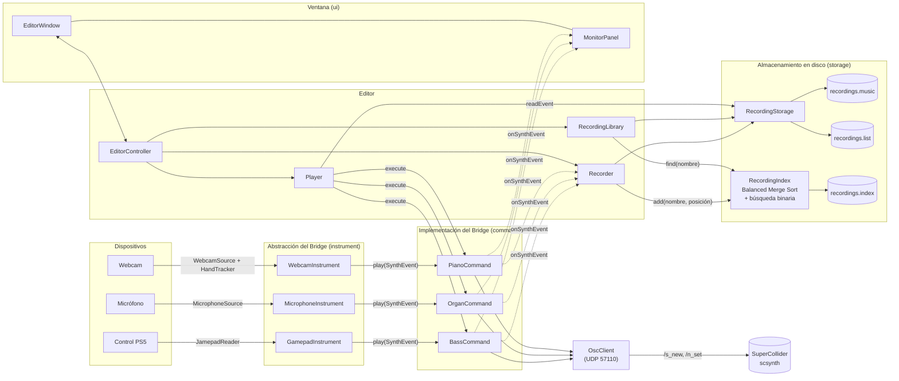
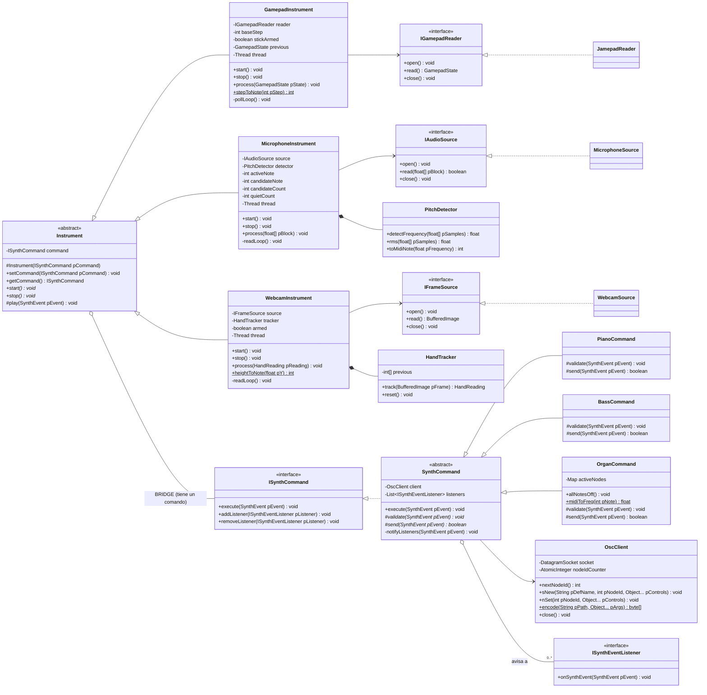
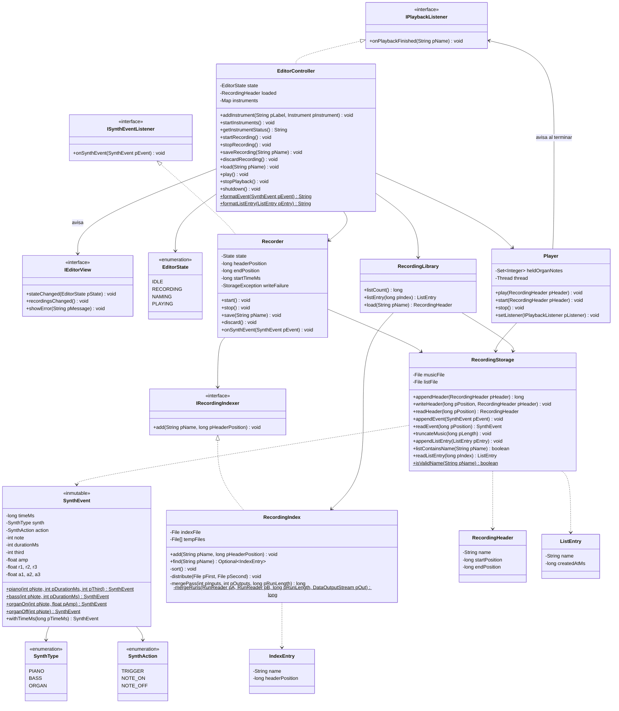
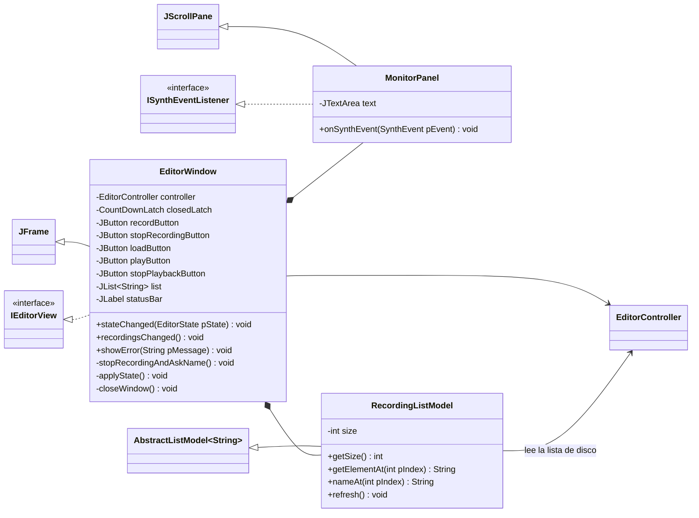
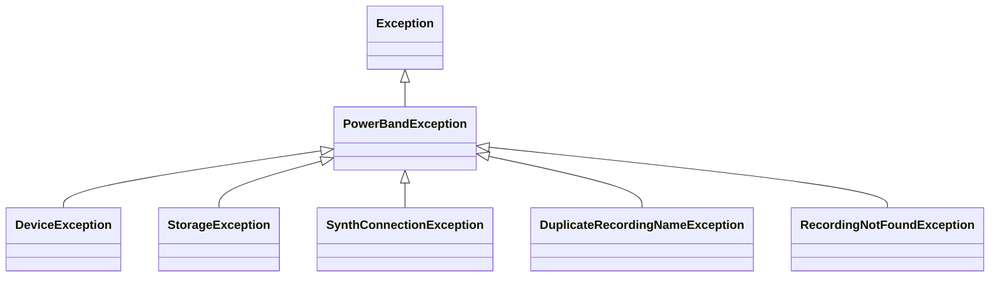
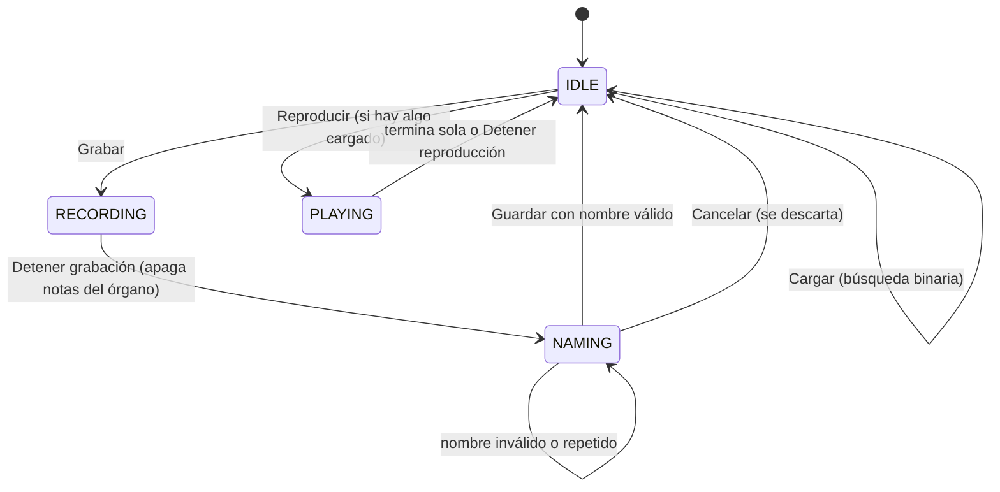
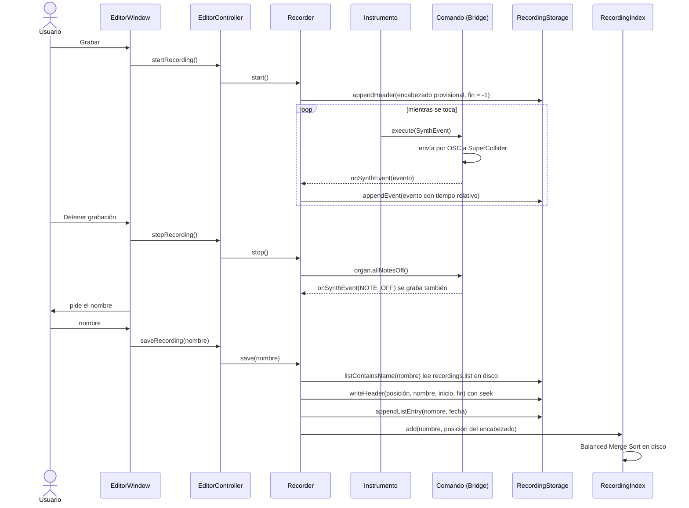
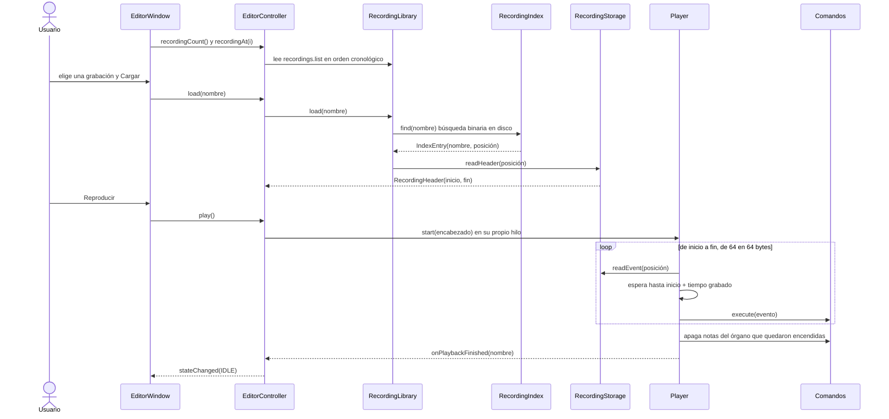
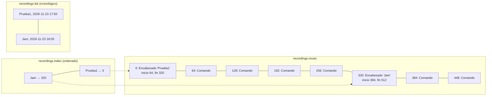
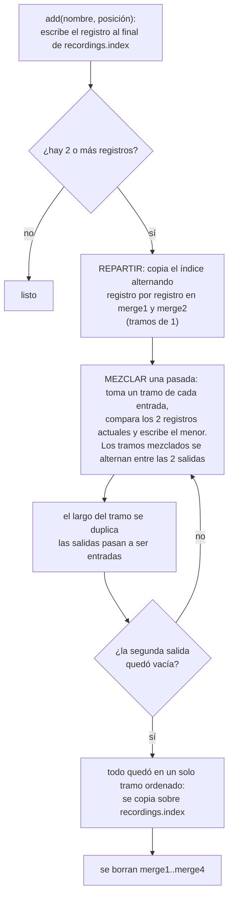

# Power Band (Caso #3 - POO)

Programa de creación e interacción musical: 3 instrumentos físicos controlan 3 synths de SuperCollider, y un editor graba, guarda, carga y reproduce la música.

| Dispositivo | Instrumento (Java) | Comando | Synth (SuperCollider) |
|---|---|---|---|
| Control PS5 (DualSense) | `GamepadInstrument` | `BassCommand` | `stringBass` |
| Micrófono (violín, guitarra, voz) | `MicrophoneInstrument` | `OrganCommand` | `organ70s` |
| Webcam | `WebcamInstrument` | `PianoCommand` | `classicPiano` |

## Prerrequisitos

| Herramienta | Verificar |
|---|---|
| JDK (versión de `pom.xml`) | `java -version` |
| Apache Maven 3.9+ | `mvn -version` |
| SuperCollider | https://supercollider.github.io/downloads.html |
| Claude Code | `claude --version` |

## Antes de arrancar (para que la demo no falle)

1. **Conectar los audífonos y el control antes de abrir SuperCollider.** SuperCollider elige la salida de audio al encender el servidor; si se cambia un dispositivo con el servidor encendido, el servidor se cuelga (los números de abajo a la derecha quedan en naranja).
2. **Usar audífonos.** Si el órgano sale por los parlantes, el micrófono lo escucha y la nota se queda pegada.
3. **Revisar el micrófono predeterminado de Windows.** Al conectar el control, Windows puede elegir el micrófono del DualSense como predeterminado. En *Configuración de sonido → Entrada*, elegir el micrófono real. El programa usa el micrófono predeterminado.
4. **Permiso del micrófono:** *Configuración → Privacidad y seguridad → Micrófono* → permitir a las aplicaciones de escritorio.
5. **Cerrar Steam** (puede quedarse con el control) y cualquier programa que esté usando la webcam.

## Preparar SuperCollider

1. Abrir `recursos/supercollider/myband.sc` en el IDE de SuperCollider.
2. Evaluar el bloque entre paréntesis (Ctrl+Enter).
3. Evaluar esta línea, para que SuperCollider no use el micrófono (solo genera sonido y así no se pelea con Java por él):
   ```supercollider
   Server.default.options.numInputBusChannels = 0;
   ```
4. Evaluar `~myband.load;` y esperar el mensaje `myband: classicPiano, stringBass, organ70s loaded`. Los números de abajo a la derecha deben quedar en **verde**.

Si los números quedan en naranja: *Server → Kill All Servers* y repetir los pasos 2 a 4.

## Correr el programa

Desde esta carpeta (donde está `pom.xml`):

```powershell
mvn compile exec:java
```

Se abre la ventana del editor. La barra de abajo muestra qué instrumentos iniciaron y cuáles fallaron (si uno falla, los demás siguen).

- **Grabar** → tocar → **Detener grabación** → escribir el nombre (máximo 32 caracteres, sin tildes ni ñ; no se puede repetir).
- Elegir una grabación de la lista → **Cargar** (búsqueda binaria en el índice) → **Reproducir**.

## Pruebas

```powershell
mvn clean verify
```

Las pruebas no necesitan SuperCollider ni dispositivos: usan un receptor UDP falso y dispositivos falsos.

## Flujo de trabajo con IA (spec driven development)

1. `/generate-feature-spec <descripción>` → crea `specs/<capa>/ft-N-*.md` en `draft`.
2. Revisar y editar la spec a mano, luego cambiar a `status: approved`.
3. `/develop-feature ft-N` → implementa y corre las pruebas.
4. `/update-current-development` → actualiza los mapas de `.claude/skills/`.

---

# Diagramas

## 1. Vista general: cómo se conecta todo

Cada dispositivo lo lee su instrumento en un hilo propio. El instrumento arma un `SynthEvent` y se lo pasa a su comando (Bridge). El comando lo manda a SuperCollider por OSC/UDP y avisa a sus observadores: el grabador (que lo escribe en disco) y el monitor de la ventana (que lo muestra). El reproductor lee los comandos de disco y los manda **por los mismos comandos**.



Líneas punteadas = patrón **Observador** (`ISynthEventListener`). Líneas sólidas = llamadas directas.

## 2. Patrón Bridge: instrumentos y comandos

La **abstracción** (`Instrument`) y la **implementación** (`ISynthCommand`) son dos jerarquías separadas. Cada instrumento *tiene* un comando (composición), no hereda de él, y se puede cambiar con `setCommand` sin tocar la clase del instrumento. Cada instrumento lee su dispositivo detrás de una interfaz (`IGamepadReader`, `IAudioSource`, `IFrameSource`), así las pruebas usan dispositivos falsos.



- `SynthCommand.execute` es un **Template Method**: valida → pone la hora → `send` (cada hijo) → avisa a los observadores.
- `ISynthEventListener` es el **Observador**: lo implementan `Recorder` y `MonitorPanel`.

## 3. Editor, almacenamiento y modelo



- `Recorder` y `Player` reciben los mismos 3 comandos que los instrumentos (el `Player` los usa para reproducir sin instrumentos).
- `IRecordingIndexer` es el punto de unión entre la grabación (ft-5) y el índice (ft-6).

## 4. Ventana (Swing)



`EditorController` no conoce Swing (solo `IEditorView`), por eso se prueba sin abrir ventanas. Todo lo que toca la ventana pasa por `SwingUtilities.invokeLater`.

## 5. Excepciones propias

Todas son *checked* (heredan de `Exception` a través de `PowerBandException`).



| Excepción | Cuándo |
|---|---|
| `DeviceException` | No hay control, micrófono o webcam, o no se pudo abrir. |
| `SynthConnectionException` | Puerto inválido, host que no existe o fallo al enviar por UDP. |
| `StorageException` | Error al leer o escribir los archivos (envuelve la `IOException`). |
| `DuplicateRecordingNameException` | El nombre ya está en `recordings.list`. |
| `RecordingNotFoundException` | La búsqueda binaria no encontró el nombre. |

## 6. Estados del editor



No se puede grabar mientras se reproduce (se grabaría la reproducción) ni reproducir mientras se graba.

## 7. Grabar



## 8. Cargar y reproducir



## 9. Formato de los archivos binarios

Todos los registros de un mismo archivo miden lo mismo, así se puede saltar a cualquiera con `posición = número × tamaño`.

**`recordings.music`**: registros de **64 bytes**, uno tras otro. Cada grabación es un encabezado seguido de sus comandos.

| Encabezado | Bytes | | Comando | Bytes |
|---|---|---|---|---|
| tipo = 1 | 1 | | tipo = 2 | 1 |
| nombre (ASCII, relleno con espacios) | 32 | | tiempo relativo (ms) | 8 |
| posición de inicio | 8 | | synth (1 piano, 2 bajo, 3 órgano) | 1 |
| posición de fin | 8 | | acción (1 disparar, 2 encender, 3 apagar) | 1 |
| relleno | 15 | | nota | 4 |
| | | | duración (ms) | 4 |
| | | | tercera | 4 |
| | | | volumen | 4 |
| | | | r1, r2, r3 | 12 |
| | | | a1, a2, a3 | 12 |
| | | | relleno | 13 |
| **Total** | **64** | | **Total** | **64** |

**`recordings.list`**: registros de **40 bytes** (nombre 32 + fecha en ms 8), en orden cronológico.

**`recordings.index`**: registros de **40 bytes** (nombre 32 + posición del encabezado 8), ordenados por nombre.



Escritura: cada registro se arma en memoria con `DataOutputStream` sobre `ByteArrayOutputStream` (así mide exactamente 64 o 40 bytes) y se escribe de una vez con `RandomAccessFile`. La lectura secuencial de `recordings.list` usa `DataInputStream` sobre `BufferedInputStream` sobre `FileInputStream`.

## 10. Balanced Merge Sort del índice

Al guardar cada grabación, `RecordingIndex.add` agrega el registro al final de `recordings.index` (queda desordenado) y lo reordena **en disco** con 4 archivos temporales. En memoria solo están los 2 registros que se comparan.



Ejemplo con 4 nombres (`d, b, a, c`):

| Paso | Entrada 1 | Entrada 2 | Salida 1 | Salida 2 |
|---|---|---|---|---|
| Repartir (tramos de 1) | `d`, `a` | `b`, `c` | | |
| Pasada 1 (tramos de 1 → 2) | `d`, `a` | `b`, `c` | `b d` | `a c` |
| Pasada 2 (tramos de 2 → 4) | `b d` | `a c` | `a b c d` | *(vacía → terminó)* |

**Búsqueda binaria** (`RecordingIndex.find`): con `RandomAccessFile` lee solo el registro del medio (`seek(medio × 40)`), compara el nombre y descarta la mitad que no sirve, hasta encontrarlo o quedarse sin registros.
